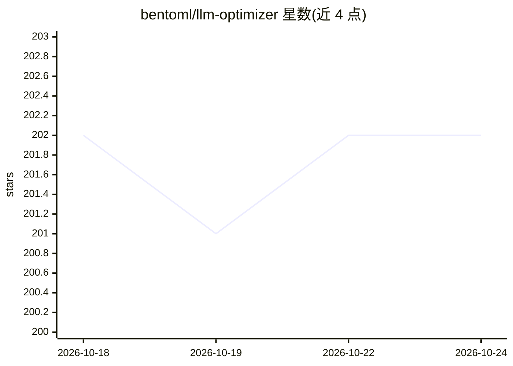

# bentoml/llm-optimizer

⭐ 202 · Python · Apache-2.0 · 推送 2026-10-20 · [GitHub](https://github.com/bentoml/llm-optimizer) · [官网](https://www.bentoml.com/llm-perf/) · 组织维护

**开源 LLM 推理性能的基准测试与调优工具**

BentoML 维护的 Python CLI 工具：跨 SGLang 与 vLLM 等推理框架，使用各框架原生参数批量测试不同服务端与客户端配置组合，自动寻找满足 SLO 约束（如 TTFT、吞吐）的最优配置。支持基于 TFLOPS 规格的理论性能估算（无需实际运行基准），支持 H100/A100/B200 等 GPU 型号检测与指定，结果保存为 JSON 并提供交互式 Pareto 可视化仪表盘（实验性功能）。面向部署 LLM 推理服务的开发与运维人员。

## 筛选速览

| 维度 | 判定 | 备注 |
|---|---|---|
| AI 角色 | `ai-ecosystem` | LLM/agent 周边工具 |
| 许可风险 | `permissive` | Apache-2.0 |
| 部署形态 | `library` | 以包/库形式分发 |
| 模型依赖 | local-ok | 支持本地模型 |
| 硬件要求 | — | 无带数字的原话,不猜 |
| 安装摩擦 | `low` | 无编译、无系统依赖或容器化 |
| 成熟度 | `idea` | |

## 能力要点

- 跨 SGLang/vLLM 框架使用原生参数批量运行基准测试
- 基于 SLO 约束（mean/median/p95/p99）过滤满足性能目标的配置
- 无需实际运行的理论性能估算（延迟/吞吐/并发上限）
- 交互式 Pareto 前沿可视化仪表盘

## 适用场景

- 为 LLM 推理服务找到满足延迟/吞吐 SLO 的最优配置
- 对比 SGLang 与 vLLM 在不同 TP/DP 组合下的性能
- 在跑基准前估算某模型在某 GPU 上的理论性能

## 场景标签

 · 领域:LLM 推理基础设施

## 证据(README 行号)

> L3: llm-optimizer is a Python tool for benchmarking and optimizing inference performance of any open-source LLMs.
> L64: Currently, llm-optimizer supports benchmarking with SGLang and vLLM to test different configurations of an LLM.
> L144: llm-optimizer exposes both server- and client-side parameters so you can experiment with different setups and meas

## 星数曲线

2026-10-18 202 → 2026-10-24 202（+0）

---
*卡片 v1 · prompt 1.4 · 生成 2026-10-22 · 置信度 high · 依据 README sha `3adce3ef0c13` · [字段定义](../../DATASET.md)*
