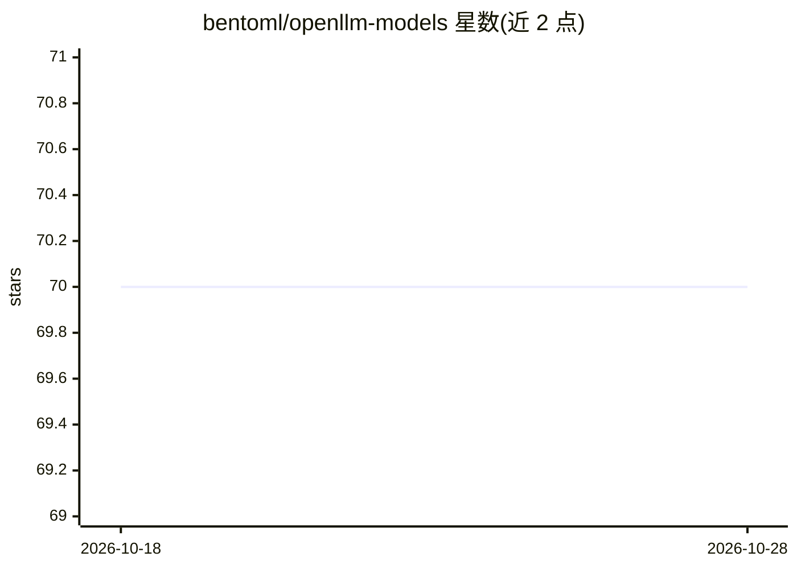

# bentoml/openllm-models

⭐ 70 · Python · 推送 2026-07-14 · [GitHub](https://github.com/bentoml/openllm-models) · 组织维护

**openllm 默认模型仓库：提供可运行模型定义集合**

BentoML 维护的 openllm 默认模型仓库，main 分支随 openllm 默认内置，包含模型定义及所需 GPU 内存、支持平台等元信息，可通过 openllm model list 查看。另提供 nightly 分支收录更新但未经测试的模型，用 openllm repo add 添加。开发者可通过向 nightly 分支提交 PR 添加或更新模型，也可 fork 后用 openllm repo add 接入自有模型仓库。

## 筛选速览

| 维度 | 判定 | 备注 |
|---|---|---|
| AI 角色 | `ai-ecosystem` | LLM/agent 周边工具 |
| 许可风险 | `none` | — |
| 部署形态 | `None` |  |
| 模型依赖 | — | README 未给出锁定关系 |
| 硬件要求 | — | 无带数字的原话,不猜 |
| 安装摩擦 | `low` | 无编译、无系统依赖或容器化 |
| 成熟度 | — | 结构信号不足 |

## 能力要点

- main 分支被 openllm 默认内置
- nightly 分支提供更新但未经测试的模型
- 模型条目含所需 GPU 内存与平台等元信息
- 支持 fork 自建模型仓库并通过 openllm repo add 使用

## 适用场景

- 为 openllm 查找可部署的模型
- 向 openllm 生态添加或更新模型定义
- 维护组织内部的自定义模型仓库

## 场景标签

`精选清单` · 领域:学习与行业

## 证据(README 行号)

> L1: The default model repository of openllm
> L3: This repo (on `main` branch) is already included by openllm by default.

## 星数曲线

2026-10-18 70 → 2026-10-28 70（+0）

---
*卡片 v1 · prompt 1.4 · 生成 2026-10-24 · 置信度 high · 依据 README sha `d9070263f6a5` · [字段定义](../../DATASET.md)*
