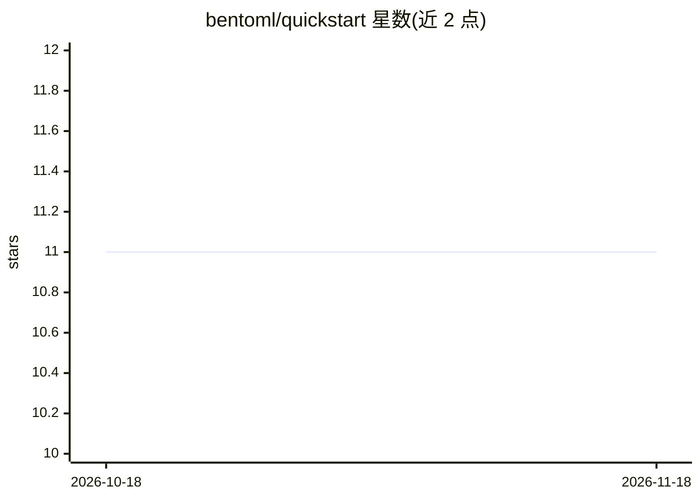

# bentoml/quickstart

⭐ 11 · Python · Apache-2.0 · 推送 2026-11-09 · [GitHub](https://github.com/bentoml/quickstart) · 组织维护

**BentoML 官方快速上手示例：构建并部署文本摘要服务**

BentoML 官方快速入门示例工程，演示如何使用来自 Hugging Face Model Hub 的 Transformer 模型构建文本摘要应用。流程为：克隆仓库、通过 pip 安装 BentoML 与 torch/transformers 依赖、用 bentoml serve 在本地 3000 端口以 HTTP 服务形式提供模型，随后构建 Bento 并以 Docker 容器化部署到 BentoCloud 或任何 Docker 兼容环境。前提条件为 Python 3.8+ 与 pip。

## 筛选速览

| 维度 | 判定 | 备注 |
|---|---|---|
| AI 角色 | `ai-ecosystem` | LLM/agent 周边工具 |
| 许可风险 | `permissive` | Apache-2.0 |
| 部署形态 | `library` | 以包/库形式分发 |
| 模型依赖 | — | README 未给出锁定关系 |
| 硬件要求 | — | 无带数字的原话,不猜 |
| 安装摩擦 | `low` | 无编译、无系统依赖或容器化 |
| 成熟度 | — | 结构信号不足 |

## 能力要点

- 演示 Hugging Face Transformer 模型封装为 BentoML HTTP 服务
- 支持构建 Bento 并容器化后部署到任意 Docker 兼容环境
- 提供部署到 BentoCloud 的完整步骤

## 适用场景

- 初次接触 BentoML 时按步骤搭建第一个模型服务
- 了解如何把 Hugging Face 模型打包并容器化部署
- 参照示例将模型服务部署到 BentoCloud

## 场景标签

`教程课程` `推理引擎` · 领域:学习与行业

## 证据(README 行号)

> L3: This quickstart demonstrates how to build a text summarization application with a Transformer model from the Hugging
> L11: Perform the following steps to run this project and deploy it to BentoCloud.

## 星数曲线

2026-10-18 11 → 2026-11-18 11（+0）

---
*卡片 v1 · prompt 1.4 · 生成 2026-11-18 · 置信度 high · 依据 README sha `1309d3d50d06` · [字段定义](../../DATASET.md)*
