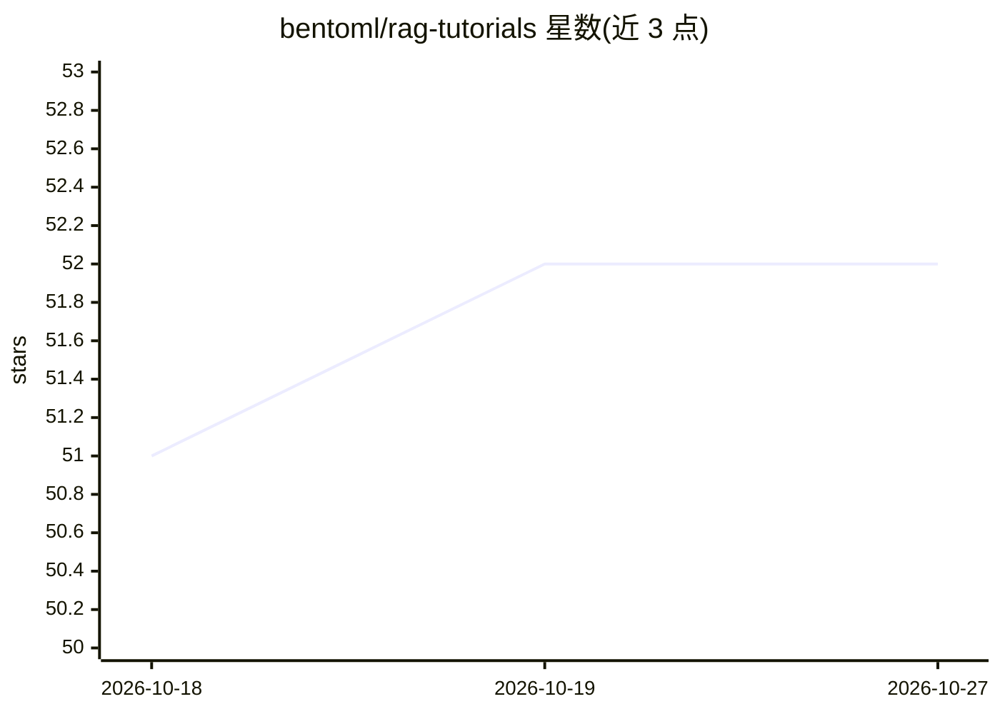

# bentoml/rag-tutorials

⭐ 52 · Python · 推送 2026-07-14 · [GitHub](https://github.com/bentoml/rag-tutorials) · 组织维护

**用 BentoML 与 LlamaIndex 分步构建自托管 RAG 服务的教程集**

BentoML 官方示例项目，含五篇递进式教程：先用 LlamaIndex 搭建本地 RAG 系统，再转为 BentoML Web 服务，随后替换默认 OpenAI 嵌入模型与问答 LLM 为自定义模型，最后接入 Milvus 向量数据库管理文档索引。面向想学习构建自托管 RAG 服务的开发者，每篇教程自包含并附运行说明；通过 git clone 源码并按 requirement.txt 安装 Python 依赖（推荐 Python 3.11）运行。

## 筛选速览

| 维度 | 判定 | 备注 |
|---|---|---|
| AI 角色 | `ai-knowledge` | 知识聚合/清单类 |
| 许可风险 | `none` | — |
| 部署形态 | `library` | 以包/库形式分发 |
| 模型依赖 | — | README 未给出锁定关系 |
| 硬件要求 | — | 无带数字的原话,不猜 |
| 安装摩擦 | `low` | 无编译、无系统依赖或容器化 |
| 成熟度 | — | 结构信号不足 |

## 能力要点

- 五篇递进式教程覆盖本地 RAG 到可扩展 Web 服务
- 演示将默认 OpenAI 嵌入模型与 LLM 替换为自定义模型
- 包含 Milvus 向量数据库集成教程

## 适用场景

- 跟着教程学习用 BentoML 部署自托管 RAG 服务
- 了解如何用自定义嵌入模型和 LLM 替换 OpenAI 默认组件
- 学习在 RAG 系统中集成 Milvus 向量数据库

## 场景标签

`教程课程` `RAG` · 领域:知识与检索

## 证据(README 行号)

> L3: This is a BentoML example project, containing a series of tutorials where we build a complete self-hosted Retrieval-
> L11: This repository contains a series of five tutorials designed to progressively build a RAG system with custom embedd

## 星数曲线

2026-10-18 51 → 2026-10-27 52（+1）

---
*卡片 v1 · prompt 1.4 · 生成 2026-10-24 · 置信度 high · 依据 README sha `f128e2c54ed4` · [字段定义](../../DATASET.md)*
