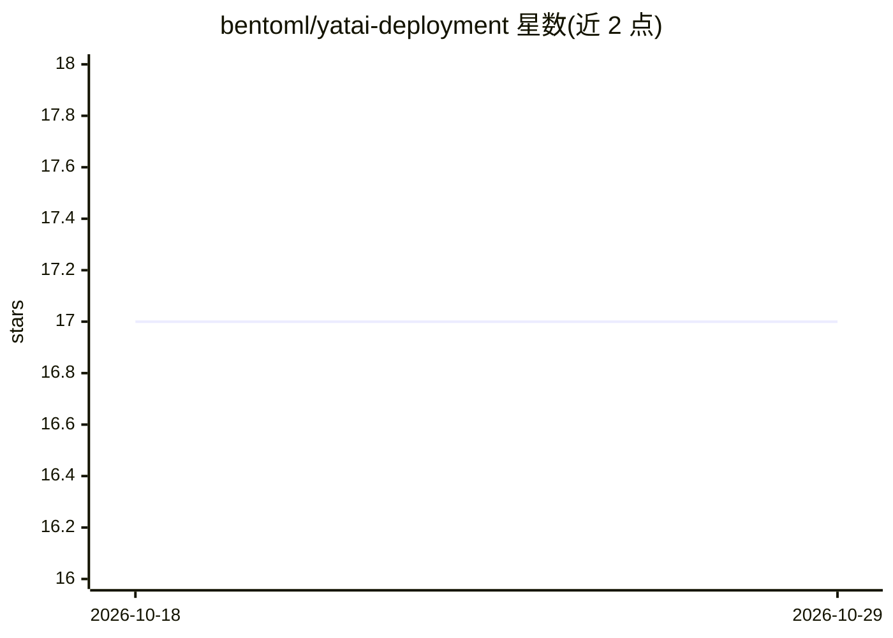

# bentoml/yatai-deployment

⭐ 17 · Go · 推送 2026-10-23 · [GitHub](https://github.com/bentoml/yatai-deployment) · 组织维护

**在 Kubernetes 上部署 Bento 的 operator 组件**

yatai 生态的 Kubernetes operator，负责监听并调和 BentoDeployment CRD，据此为 Bento 创建工作负载与服务。它依赖 Bento CR 获取镜像与 runners 信息，因此需在 yatai-image-builder 组件之后安装。项目遵循 Kubernetes Operator 模式，使用 Controller 的 reconcile 循环将集群同步至期望状态。面向使用 yatai 管理 BentoML 模型部署的运维/开发人员，安装方式参考官方安装指南，开发时可用 make install/ start-dev 在集群中测试。

## 筛选速览

| 维度 | 判定 | 备注 |
|---|---|---|
| AI 角色 | `ai-ecosystem` | LLM/agent 周边工具 |
| 许可风险 | `none` | — |
| 部署形态 | `None` |  |
| 模型依赖 | — | README 未给出锁定关系 |
| 硬件要求 | — | 无带数字的原话,不猜 |
| 安装摩擦 | `medium` | 含编译或系统依赖之一 |
| 成熟度 | — | 结构信号不足 |

## 能力要点

- BentoDeployment CRD 的 operator，调和 CR 并创建工作负载与服务
- 遵循 Kubernetes Operator 模式，基于 Controller reconcile 机制
- 依赖 Bento CR 提供镜像与 runners 信息，需先装 yatai-image-builder

## 适用场景

- 在 Kubernetes 集群中以 CRD 声明式方式部署 BentoML 模型
- 作为 yatai 平台的部署组件实现 Bento 服务的自动化编排
- 开发/调试自定义 BentoDeployment 资源与控制器逻辑

## 场景标签

`推理引擎` · 领域:训练与推理

## 证据(README 行号)

> L3: yatai-deployment is a yatai component dedicated to deploying Bento to Kubernetes
> L7: yatai-deployment runs in k8s, it is the operator of `BentoDeployment` CRD, it is responsible for reconcile `BentoDep

## 星数曲线

2026-10-18 17 → 2026-10-29 17（+0）

---
*卡片 v1 · prompt 1.4 · 生成 2026-10-29 · 置信度 high · 依据 README sha `9cad7447cac4` · [字段定义](../../DATASET.md)*
