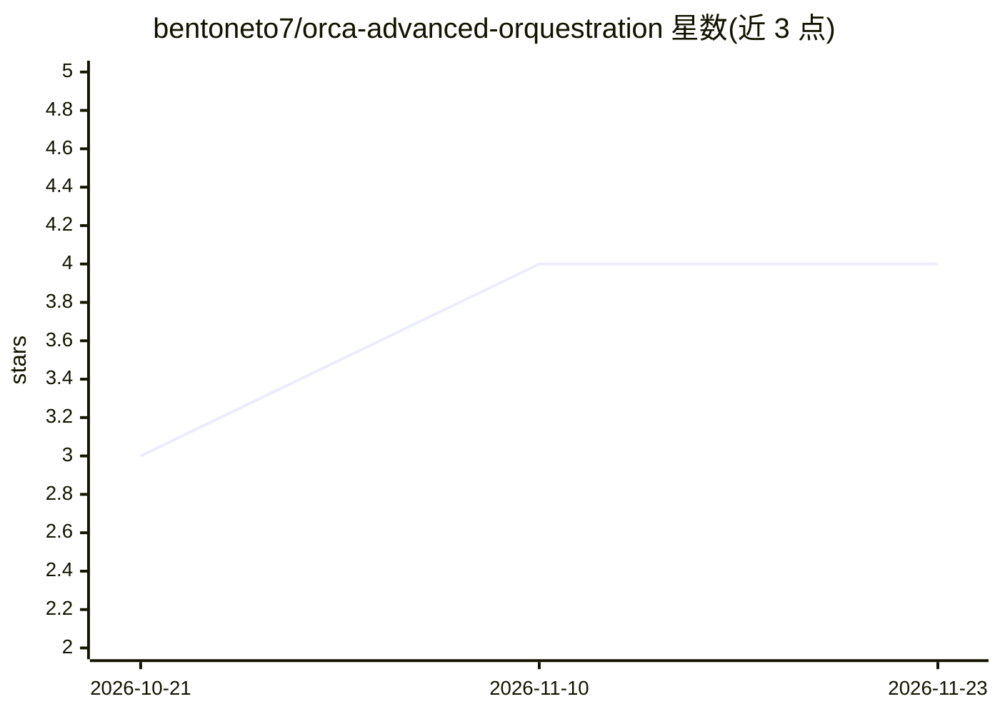

# bentoneto7/orca-advanced-orquestration

⭐ 4 · JavaScript · 推送 2026-10-16 · [GitHub](https://github.com/bentoneto7/orca-advanced-orquestration) · 个人维护 · 中文 README

**在 Orca 中并行编排六个 AI 编码 agent 的多智能体编排配置**

面向 Orca 的多 agent 编排技能配置：一条请求分发到 Claude Code、Codex CLI、Cursor CLI、Grok CLI、Antigravity CLI（Gemini）与 Muse 六个 agent，各自在独立 git worktree 中并行工作。每轮任务前用零 token 命令读取各订阅的真实配额，按余量分配任务，触限 agent 被即时替换；子 agent 免确认执行并跨厂商互审，主 agent 配额耗尽时可通过 promote 命令由其他 agent 接管。提供 macOS/Linux（Bash）与 Windows（PowerShell）安装脚本，无 API key，各 CLI 通过浏览器登录自有订阅。

## 筛选速览

| 维度 | 判定 | 备注 |
|---|---|---|
| AI 角色 | `ai-ecosystem` | LLM/agent 周边工具 |
| 许可风险 | `none` | — |
| 部署形态 | `None` |  |
| 模型依赖 | — | README 未给出锁定关系 |
| 硬件要求 | — | 无带数字的原话,不猜 |
| 安装摩擦 | `low` | 无编译、无系统依赖或容器化 |
| 成熟度 | — | 结构信号不足 |

## 能力要点

- 六个 AI agent 在各自 git worktree 中按波次并行执行
- 每轮任务前零 token 读取各 agent 真实配额并按余量分配
- 跨厂商互审与触限任务的自动重分配
- 协调者配额耗尽时任意 agent 可接管（promote 命令）

## 适用场景

- 用多个订阅的编码 agent 并行处理开发任务
- 避免单一 agent 用量超限导致任务中断
- 让不同厂商的 agent 互相审查代码交付

## 场景标签

`多智能体` `编码 Agent` · 领域:Agent 开发

## 证据(README 行号)

> L12: `orca-advanced-orquestration` is a **multi-agent orchestration** setup for **AI coding agents**. One request to the
> L26: - **Installers for macOS, Linux and Windows.** One command installs and checks everything in every AI.

## 星数曲线

2026-10-21 3 → 2026-11-23 4（+1）

---
*卡片 v1 · prompt 1.4 · 生成 2026-11-21 · 置信度 high · 依据 README sha `525b1e7031d3` · [字段定义](../../DATASET.md)*
