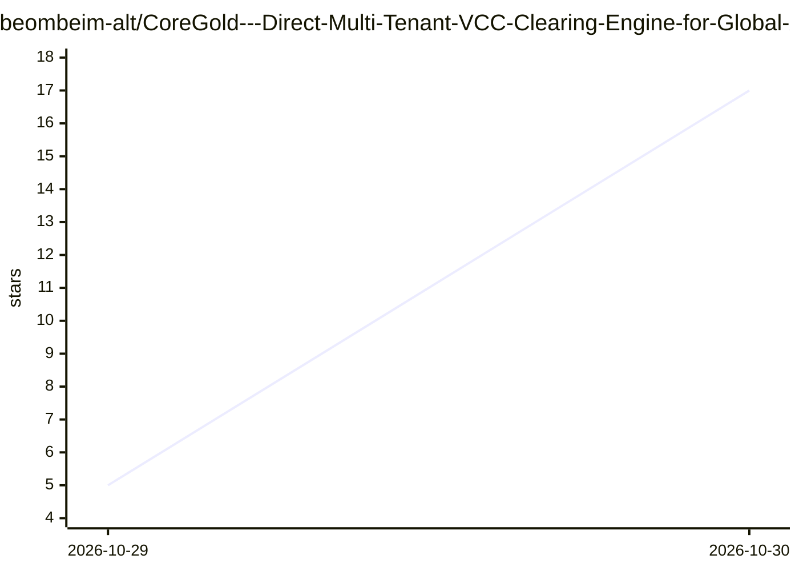

# beombeim-alt/CoreGold---Direct-Multi-Tenant-VCC-Clearing-Engine-for-Global-Ad-Scalers-Media-Agencies

⭐ 17 · 推送 2026-10-28 · [GitHub](https://github.com/beombeim-alt/CoreGold---Direct-Multi-Tenant-VCC-Clearing-Engine-for-Global-Ad-Scalers-Media-Agencies) · [官网](https://app.coregold.io/signup?invite_code=ADvlj9b) · 组织维护 · 中文 README

**面向出海团队的虚拟信用卡（VCC）发卡与风控商业服务**

CoreGold 是一项虚拟信用卡发行服务，通过线上控制台提供批量制卡、多币种商业卡段、USDT 充值兑换、单卡商户绑定与交易熔断、销卡余额回退、团队多级权限与账单明细等功能。面向跨境电商、广告投放团队与多项目财务核算场景，使用方式为注册账号后充值并自助开卡，属于托管型商业服务而非可安装的开源软件。README 与 AI 无实际功能关联，仅在业务矩阵中将 OpenAI/Anthropic/Cursor 列为可付款的服务商。

## 筛选速览

| 维度 | 判定 | 备注 |
|---|---|---|
| AI 角色 | `ai-enhanced` | 去掉 AI 部分产品仍成立 |
| 许可风险 | `none` | — |
| 部署形态 | `None` |  |
| 模型依赖 | — | README 未给出锁定关系 |
| 硬件要求 | — | 无带数字的原话,不猜 |
| 安装摩擦 | `low` | 无编译、无系统依赖或容器化 |
| 成熟度 | — | 结构信号不足 |

## 能力要点

- 线上控制台批量生成虚拟卡（卡号/有效期/CVV）
- 单卡商户指纹绑定、限额与交易熔断配置
- USDT 链上充值按实时汇率转为美元余额
- 团队多级权限与按项目的账单核算

## 适用场景

- 投放团队为多个广告账户分配独立卡号
- 独立站站群一店一卡做资金隔离
- 为海外 SaaS 订阅设定预算并阻断异常扣费

## 场景标签

 · 领域:金融科技/跨境支付

## 证据(README 行号)

> L33: |**AI 算力与开发基础设施**|`OpenAI API`, `Anthropic (Claude)`, `Cursor`, `AWS / GCP`|轻松突破海外开发者订阅的发卡地限制，支持高频自动化充值扣费|

## 星数曲线

2026-10-29 5 → 2026-10-30 17（+12）

---
*卡片 v1 · prompt 1.4 · 生成 2026-10-30 · 置信度 low · 依据 README sha `7e0df1931bfd` · [字段定义](../../DATASET.md)*
