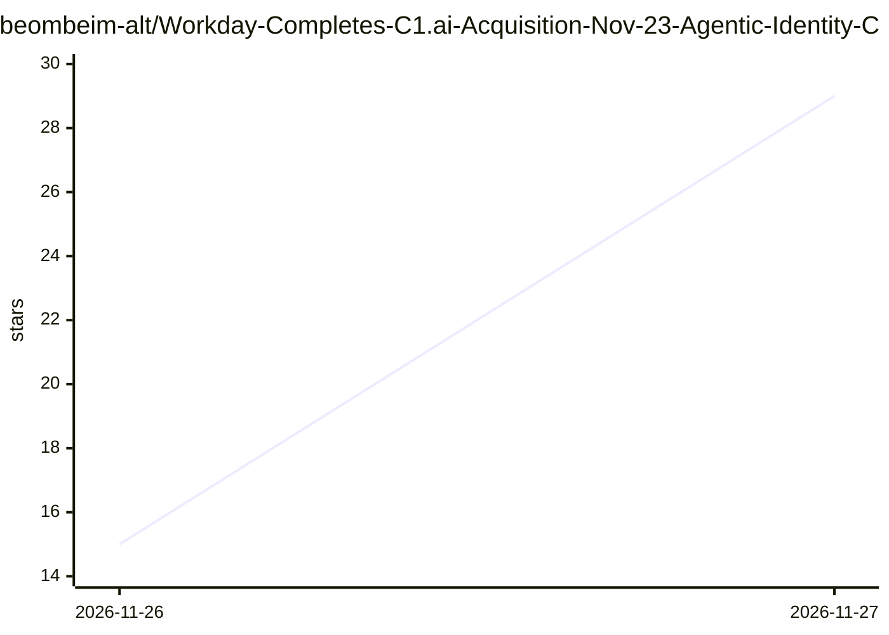

# beombeim-alt/Workday-Completes-C1.ai-Acquisition-Nov-23-Agentic-Identity-Clean-Billing-Ownership

⭐ 29 · 推送 2026-11-24 · [GitHub](https://github.com/beombeim-alt/Workday-Completes-C1.ai-Acquisition-Nov-23-Agentic-Identity-Clean-Billing-Ownership) · [官网](https://app.coregold.io/signup?invite_code=ADvlj9b) · 个人维护 · 中文 README

**面向团队的虚拟卡开卡与 USDT 充值操作教程**

该仓库以 Workday 收购 C1.ai 为引子，正文是一份第三方虚拟卡服务 CoreGold 的使用指南：注册账号、通过 TRC20 网络从 OKX/Binance 充值 USDT、选择个人或团队套餐开卡、填写账单地址、查看卡号并绑定 Apple Pay/Google Pay；另附卡信息保密、账单地址一致性、闲置卡冻结等 4 条操作习惯。仓库不含源代码，无安装与构建步骤，属于操作教程与推广页面组合。

## 筛选速览

| 维度 | 判定 | 备注 |
|---|---|---|
| AI 角色 | `ai-knowledge` | 知识聚合/清单类 |
| 许可风险 | `none` | — |
| 部署形态 | `None` |  |
| 模型依赖 | — | README 未给出锁定关系 |
| 硬件要求 | — | 无带数字的原话,不猜 |
| 安装摩擦 | `low` | 无编译、无系统依赖或容器化 |
| 成熟度 | — | 结构信号不足 |

## 能力要点

- 个人/团队套餐开卡与多卡管理流程说明
- TRC20 网络 USDT 充值的分步操作指引
- 虚拟卡绑定 Apple Pay/Google Pay 的验证流程
- 卡号/CVV/验证码保密与闲置卡冻结等操作习惯

## 适用场景

- 为团队多人软件订阅分卡并追踪归属与余额
- 用 USDT 充值开虚拟卡并绑定手机钱包支付

## 场景标签

`教程课程` · 领域:学习与行业

## 证据(README 行号)

> L5: **Agentic Identity & Seat Ownership: Keeping Software Billing Clear Across Teams**
> L11: ## Practical Knowledge: 4 Habits for Clear Billing & Seat Ownership
> L27: ## Simple Step-by-Step Setup Tutorial

## 星数曲线

2026-11-26 15 → 2026-11-27 29（+14）

---
*卡片 v1 · prompt 1.4 · 生成 2026-11-26 · 置信度 mid · 依据 README sha `6519c1dfc66f` · [字段定义](../../DATASET.md)*
