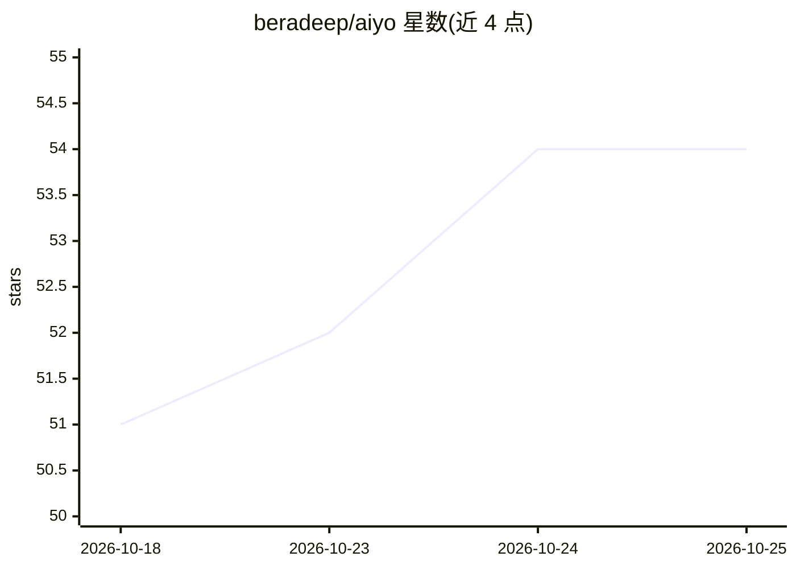

# beradeep/aiyo

⭐ 54 · Kotlin · Apache-2.0 · 推送 2026-07-25 · [GitHub](https://github.com/beradeep/aiyo) · 个人维护

**安卓 BYOK AI 聊天应用：自带 OpenRouter key 对话数百模型**

面向安卓用户的 AI 聊天应用，用户自带 OpenRouter API key 即可对话 500+ 模型。支持推理模型、网页搜索与聊天历史，声明不收集用户数据。技术栈为 Kotlin + Jetpack Compose + MVVM，使用 OpenAI Kotlin 库与 OpenRouter 交互。安装方式为从源码构建：克隆仓库后在 Android Studio 中同步 Gradle 并构建，需 Android SDK API 24+ 与 Gradle 8.0+，未提供预编译安装包下载渠道的说明。

## 筛选速览

| 维度 | 判定 | 备注 |
|---|---|---|
| AI 角色 | `ai-native` | 本体是模型或模型工具 |
| 许可风险 | `permissive` | Apache-2.0 |
| 部署形态 | `None` |  |
| 模型依赖 | locked-api |  |
| 硬件要求 | — | 无带数字的原话,不猜 |
| 安装摩擦 | `low` | 无编译、无系统依赖或容器化 |
| 成熟度 | — | 结构信号不足 |

## 能力要点

- BYOK 模式：自带 OpenRouter API key 访问 500+ 模型
- 支持推理、网页搜索与聊天历史
- 声明不收集用户数据
- Kotlin + Jetpack Compose + MVVM 构建

## 适用场景

- 在安卓设备上用一个应用对话多家模型
- 自己控制 API key 与数据，不在服务端留存聊天数据
- 在移动端使用支持网页搜索的 AI 对话

## 场景标签

`聊天机器人` · 领域:对话与助手

## 证据(README 行号)

> L5: Aiyo is an AI chat app that allows you to chat with hundreds of models by bringing your own OpenRouter API key. It's
> L9: - 💬 Chat with any model of your choice
> L10: - ✨ Access to over 500 models on OpenRouter

## 星数曲线

2026-10-18 51 → 2026-10-25 54（+3）

---
*卡片 v1 · prompt 1.4 · 生成 2026-10-24 · 置信度 high · 依据 README sha `ed04109e1090` · [字段定义](../../DATASET.md)*
