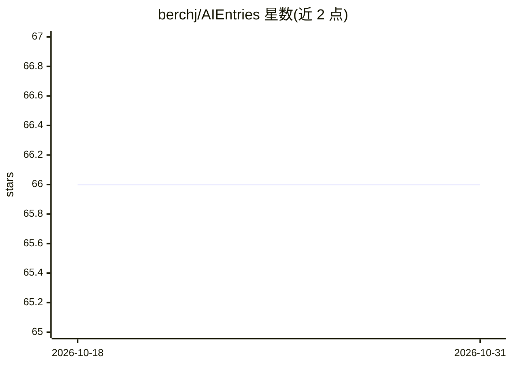

# berchj/AIEntries

⭐ 66 · PHP · NOASSERTION · 推送 2026-01-26 · [GitHub](https://github.com/berchj/AIEntries) · [官网](https://wordpress.org/plugins/ai-entries/) · 个人维护

**用 Gemini、Stability AI 与 News API 自动生成 WordPress 文章的插件**

WordPress 插件，面向 WordPress 站点管理者：在管理后台配置任意主题，插件先通过 News API 获取真实新闻文章，再用 Google Gemini API 基于真实内容生成原创文章，并用 Stability AI 根据文章标题生成特色图片，最终自动创建符合 WordPress 标准的文章。需自备三个免费 API key。本地开发依赖 Node.js、npm 与 Docker，通过 Makefile 命令启动含 WordPress 的测试环境并运行 PHPUnit 单元测试。README 声明项目为进行中状态。

## 筛选速览

| 维度 | 判定 | 备注 |
|---|---|---|
| AI 角色 | `ai-native` | 本体是模型或模型工具 |
| 许可风险 | `none` | NOASSERTION |
| 部署形态 | `library` | 以包/库形式分发 |
| 模型依赖 | — | README 未给出锁定关系 |
| 硬件要求 | — | 无带数字的原话,不猜 |
| 安装摩擦 | `low` | 无编译、无系统依赖或容器化 |
| 成熟度 | `idea` | |

## 能力要点

- News API 获取真实文章作为内容基础
- Gemini API 基于真实内容生成原创文章
- Stability AI 按文章标题生成特色图片
- Makefile 管理 Docker 本地环境、测试与打包 zip

## 适用场景

- 自动批量生成指定主题的 WordPress 博客文章
- 为站点文章自动配 AI 生成的特色图片
- 按 Google AI 内容指南生成带新闻来源的文章

## 场景标签

`AI 写作` `图像生成` `工作流自动化` · 领域:效率与自动化

## 证据(README 行号)

> L3: This plugin uses Google artificial intelligence (GEMINI) and stability.AI to automate the creation of standard WordP
> L18: We use this api to generate original content based in real one
> L24: We use this api to generate post's featured imaged based on ai generated article's title .

## 星数曲线

2026-10-18 66 → 2026-10-31 66（+0）

---
*卡片 v1 · prompt 1.4 · 生成 2026-10-24 · 置信度 mid · 依据 README sha `2f1d234bc792` · [字段定义](../../DATASET.md)*
