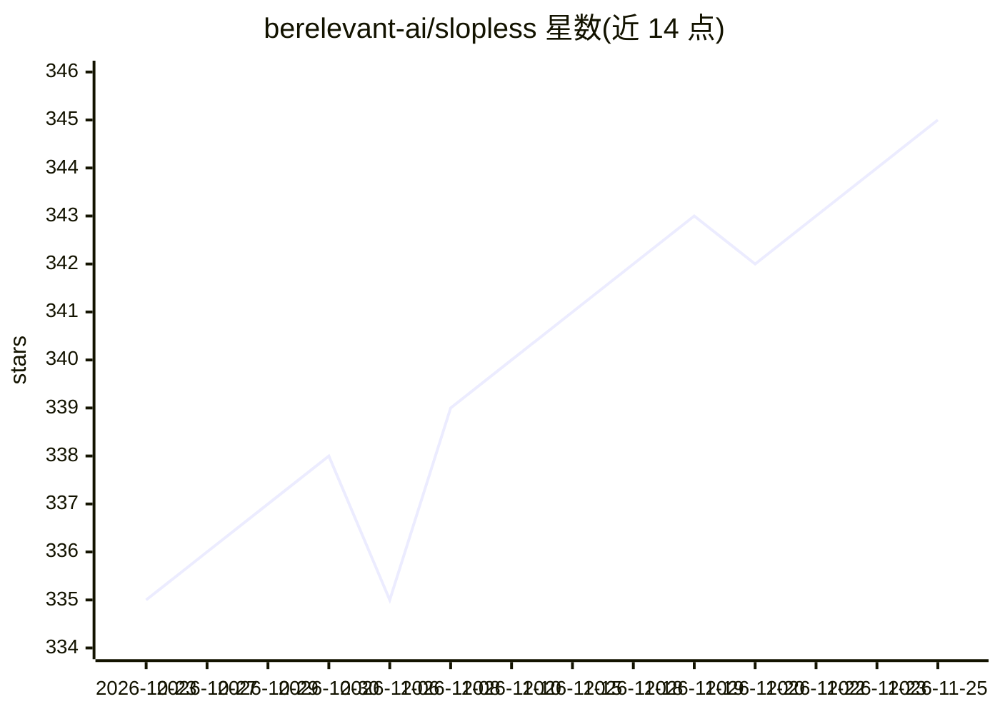

# berelevant-ai/slopless

⭐ 345 · TypeScript · MIT · 推送 2026-11-04 · [GitHub](https://github.com/berelevant-ai/slopless) · [官网](https://www.npmjs.com/package/slopless) · 个人维护

**检测英文 Markdown 中 AI 腔写作套话的 textlint 规则与 CLI**

基于 textlint 的英文散文检查工具：默认运行本地确定性规则（50+ 条，含 7 类），输出 JSON 发现项；可选启用经 TypeSafe API 的 Jev 语义检查（54 项、11 族），按段落发送请求并给出缺陷描述，需 JEV_API_KEY。提供 CLI、Node 库和 textlint preset 三种用法，并支持安装 Codex/Claude Code 技能供写作 agent 迭代改写至通过检查。仅支持英文；叙事类规则默认关闭。

## 筛选速览

| 维度 | 判定 | 备注 |
|---|---|---|
| AI 角色 | `ai-enhanced` | 去掉 AI 部分产品仍成立 |
| 许可风险 | `permissive` | MIT |
| 部署形态 | `library` | 以包/库形式分发 |
| 模型依赖 | — | README 未给出锁定关系 |
| 硬件要求 | — | 无带数字的原话,不猜 |
| 安装摩擦 | `low` | 无编译、无系统依赖或容器化 |
| 成熟度 | — | 结构信号不足 |

## 能力要点

- 默认确定性本地规则检查，输出固定 JSON 格式
- 可选 54 项 Jev 语义检查，按段落发送请求，经 TypeSafe API
- CLI 内置 textlint，无需单独安装 textlint 或配置文件
- 提供 install-skill 命令为 Codex/Claude Code 安装技能

## 适用场景

- 让写作 agent 反复改写 Markdown 直到检查通过
- 检查文档仓库中的英文 AI 生成套话
- 作为 textlint preset 加入既有 textlint 工作流

## 场景标签

 · 领域:开发者工具/文本质量检查

## 证据(README 行号)

> L12: Slopless checks English Markdown for AI and human writing slop. Its default CLI runs local textlint rules. Optional
> L71: Slopless is English-only. It requires a file path, glob, or stdin input. A bare `npx slopless` exits with code `2`.
> L103: There are 54 Jev checks across eleven families. They use selected experimental definitions and cutoffs; their reco

## 星数曲线

2026-10-23 335 → 2026-11-25 345（+10）

---
*卡片 v1 · prompt 1.4 · 生成 2026-11-25 · 置信度 high · 依据 README sha `ff845c1b5150` · [字段定义](../../DATASET.md)*
