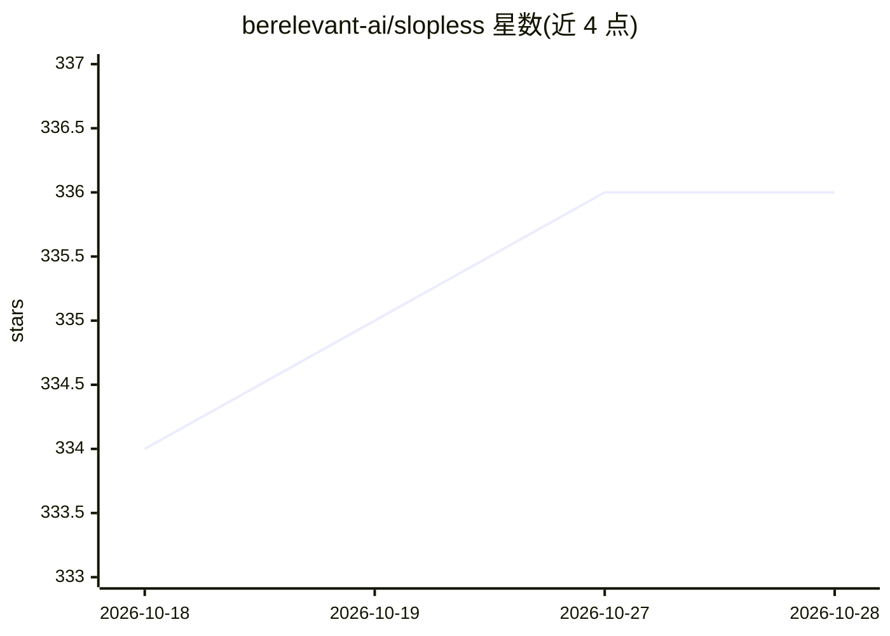

# berelevant-ai/slopless

⭐ 337 · TypeScript · MIT · 推送 2026-10-26 · [GitHub](https://github.com/berelevant-ai/slopless) · [官网](https://www.npmjs.com/package/slopless) · 组织维护

**检测英文 Markdown 中 AI 味文风的确定性 textlint 规则集与 CLI**

以 textlint preset 与零配置 CLI 两种形式提供的确定性文本检查工具：通过 50+ 条规则（如套话框架、禁用短语、虚假对比、陈词滥调等七个规则族）标记 LLM 生成的模板化文风，无需模型调用与 API key，输出固定 JSON，按退出码区分通过/发现/失败。面向写作 agent（可安装 Codex 与 Claude Code 技能）与已有 textlint 用户，用于让 agent 迭代改写直至通过检查。仅支持英文，需要文件路径、glob 或 stdin 输入。

## 筛选速览

| 维度 | 判定 | 备注 |
|---|---|---|
| AI 角色 | `ai-ecosystem` | LLM/agent 周边工具 |
| 许可风险 | `permissive` | MIT |
| 部署形态 | `library` | 以包/库形式分发 |
| 模型依赖 | — | README 未给出锁定关系 |
| 硬件要求 | — | 无带数字的原话,不猜 |
| 安装摩擦 | `low` | 无编译、无系统依赖或容器化 |
| 成熟度 | — | 结构信号不足 |

## 能力要点

- 50+ 条确定性规则（七个规则族），无模型调用、无 API key
- 零配置 CLI 内置 textlint，默认输出 JSON
- 可安装 Codex 与 Claude Code 的 agent 技能
- 可作为 preset 嵌入现有 textlint 配置，支持按规则关闭

## 适用场景

- 让写作 agent 自动检测并改写 AI 味文风直至通过
- 在现有 textlint 工作流中检查英文 Markdown 文风
- 对虚构/回忆类文本启用叙事规则检查

## 场景标签

 · 领域:文本质量/开发工具

## 证据(README 行号)

> L12: Give it to your writing agent and it stops handing you AI-slop prose. Slopless is a deterministic linter - a textli
> L59: 5. Let the agent run Slopless, rewrite, and rerun until the JSON output has no findings.

## 星数曲线

2026-10-18 334 → 2026-10-28 336（+2）

---
*卡片 v1 · prompt 1.4 · 生成 2026-10-21 · 置信度 high · 依据 README sha `302404c71d8c` · [字段定义](../../DATASET.md)*
