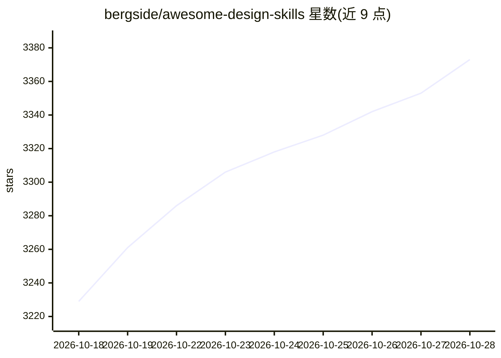

# bergside/awesome-design-skills

⭐ 3,373 · MIT · 推送 2026-06-28 · [GitHub](https://github.com/bergside/awesome-design-skills) · [官网](https://www.typeui.sh/design-skills) · 个人维护

**面向 AI 编码工具的 67 个设计系统技能文件注册表**

策展型注册表：收录 67 个设计技能，每个技能为含 SKILL.md 与 DESIGN.md 的文件夹。SKILL.md 作为 AI agent 指令源，包含品牌风格、排版与配色体系、组件家族、WCAG 2.2 AA 可访问性规则、Do/Don't 规则与质量门槛；DESIGN.md 面向人类读者记录设计意图与维护说明。通过 npx typeui.sh CLI 按 slug 拉取技能并写入指定工具的目录（如 .cursor/skills/、.claude/），支持指定 provider、dry-run 预览、交互式浏览及生成自定义技能。

## 筛选速览

| 维度 | 判定 | 备注 |
|---|---|---|
| AI 角色 | `ai-knowledge` | 知识聚合/清单类 |
| 许可风险 | `permissive` | MIT |
| 部署形态 | `library` | 以包/库形式分发 |
| 模型依赖 | — | README 未给出锁定关系 |
| 硬件要求 | — | 无带数字的原话,不猜 |
| 安装摩擦 | `low` | 无编译、无系统依赖或容器化 |
| 成熟度 | — | 结构信号不足 |

## 能力要点

- 67 个技能各含 SKILL.md（agent 指令）与 DESIGN.md（人类文档）
- npx typeui.sh 命令按 slug 拉取并写入 .cursor/skills/、.claude/ 等路径
- 支持 -p 指定 provider、--dry-run 预览、list 交互浏览、generate 生成自定义技能
- SKILL.md 覆盖排版/配色/组件/可访问性（WCAG 2.2 AA）/质量门槛

## 适用场景

- 为 Cursor、Claude Code 等 AI 编码工具配置设计系统技能
- 让 AI agent 生成符合特定视觉风格与可访问性规则的 UI 代码
- 浏览并对比 67 种设计风格供项目选型

## 场景标签

`精选清单` `提示工程` · 领域:Agent 开发

## 证据(README 行号)

> L5: > A curated registry of 67 design system skill files for AI-powered agentic tools like Claude Code, Cursor, Codex, a
> L307: `SKILL.md` acts as the instruction source for AI agents and LLMs. It contains:
> L323: When an AI agent reads a skill file, it follows the `SKILL.md` guidelines to generate UI code that is consistent, 

## 星数曲线

2026-10-18 3,229 → 2026-10-28 3,373（+144）

---
*卡片 v1 · prompt 1.4 · 生成 2026-10-21 · 置信度 high · 依据 README sha `71ba6e9689b1` · [字段定义](../../DATASET.md)*
