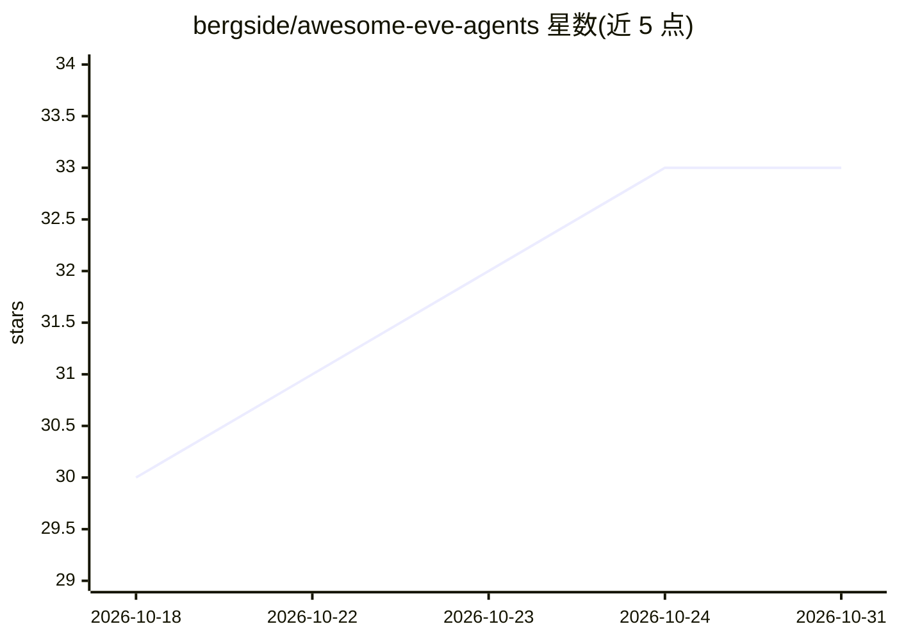

# bergside/awesome-eve-agents

⭐ 33 · JavaScript · MIT · 推送 2026-07-17 · [GitHub](https://github.com/bergside/awesome-eve-agents) · [官网](https://www.eveagents.dev/) · 组织维护

**面向 Eve 框架的开源 agent 策展清单（21 个，18 类职能）**

由 Bergside 维护的 Eve agent 集合：收录 21 个开箱即用的独立 agent，覆盖工程、产品、分析、客服、营销、财务、研究、教育等职能。每个 agent 是自包含目录（instructions.md、agent.ts、skills、示例与 .env.example），通过 npx @bergside/eveagents install <slug> 从 npm 包内置源码安装到本地，再用 npx eve@latest 运行；集成变体（Slack/GitHub/Linear/Notion 等）需在 EveAgents 目录获取。MIT 许可。

## 筛选速览

| 维度 | 判定 | 备注 |
|---|---|---|
| AI 角色 | `ai-knowledge` | 知识聚合/清单类 |
| 许可风险 | `permissive` | MIT |
| 部署形态 | `library` | 以包/库形式分发 |
| 模型依赖 | — | README 未给出锁定关系 |
| 硬件要求 | — | 无带数字的原话,不猜 |
| 安装摩擦 | `low` | 无编译、无系统依赖或容器化 |
| 成熟度 | — | 结构信号不足 |

## 能力要点

- 21 个独立 agent 覆盖工程/产品/分析/客服/营销/财务等 18 个类别
- CLI 按 slug 安装 agent 完整源码并支持 list/--dir/--force
- 每个 agent 含 instructions.md、agent.ts、skills、示例与 .env.example
- 集成变体支持 Slack/GitHub/Linear/Notion/PostHog/Stripe/Supabase

## 适用场景

- 为团队挑选现成的工程、客服或营销职能 agent
- 基于源码学习 Eve agent 的结构与写法并二次定制
- 通过 CLI 快速安装并在本地运行独立 agent

## 场景标签

`精选清单` · 领域:学习与行业

## 证据(README 行号)

> L5: > A curated collection of 21 open-source agents for Eve, covering engineering, product, analytics, support, marketin
> L113: An Eve agent is a self-contained folder that defines its identity, workflow, model, domain knowledge, and optional

## 星数曲线

2026-10-18 30 → 2026-10-31 33（+3）

---
*卡片 v1 · prompt 1.4 · 生成 2026-10-26 · 置信度 high · 依据 README sha `373ea1723e52` · [字段定义](../../DATASET.md)*
