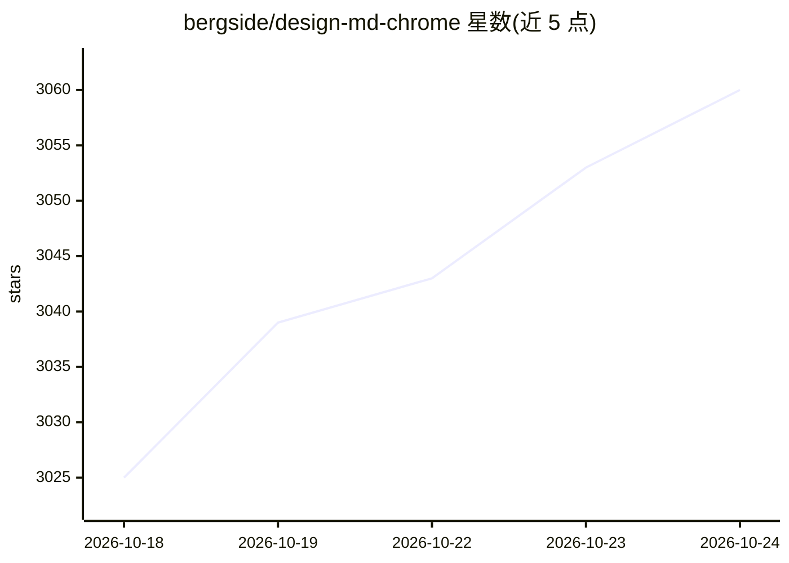

# bergside/design-md-chrome

⭐ 3,060 · JavaScript · MIT · 推送 2026-05-25 · [GitHub](https://github.com/bergside/design-md-chrome) · [官网](https://chromewebstore.google.com/detail/designmd-style-extractor/ogpdnchdjiibhobphelbbkemnnemkfma) · 个人维护

**从任意网站提取设计风格并生成 DESIGN.md/SKILL.md 的 Chrome 扩展**

Chrome 扩展：读取当前标签页的排版、颜色、间距、圆角、阴影与动效等样式信号，基于开源 TypeUI DESIGN.md 格式生成设计系统文档（DESIGN.md）或面向 agent 的技能文档（SKILL.md），供 Google Stitch、Claude Code、Codex 等工具按该设计蓝图构建网站。以 Load unpacked 方式安装，提供自动提取、刷新、下载与生成说明等操作；生成文档含品牌、视觉 token、WCAG 2.2 AA 可访问性、写作语气、规则与质量门等固定章节。本地开发可用 node 运行测试。

## 筛选速览

| 维度 | 判定 | 备注 |
|---|---|---|
| AI 角色 | `ai-ecosystem` | LLM/agent 周边工具 |
| 许可风险 | `permissive` | MIT |
| 部署形态 | `None` |  |
| 模型依赖 | — | README 未给出锁定关系 |
| 硬件要求 | — | 无带数字的原话,不猜 |
| 安装摩擦 | `low` | 无编译、无系统依赖或容器化 |
| 成熟度 | — | 结构信号不足 |

## 能力要点

- 读取活动标签页的排版/颜色/间距/圆角/阴影/动效信号
- 生成基于 TypeUI 格式的 DESIGN.md 与 agent 可用的 SKILL.md
- 生成文档包含 WCAG 2.2 AA 可访问性要求与可测试的质量门章节
- 支持 Explain（?）展示文件生成过程与 TypeUI 参考

## 适用场景

- 把喜欢的网站风格转成设计系统文档，交给 AI 编码工具复刻
- 为 Claude Code / Codex 等 agent 生成可加载的设计技能文件
- 快速沉淀现有产品的视觉 token 与设计规范

## 场景标签

`网页抓取` · 领域:效率与自动化

## 证据(README 行号)

> L3: This Chrome extension extract styles and information from any given site and generates a `DESIGN.md` or `SKILL.md` f
> L26: |Generate `SKILL.md`|Produces agent-ready skill markdown from extracted signals.|

## 星数曲线

2026-10-18 3,025 → 2026-10-24 3,060（+35）

---
*卡片 v1 · prompt 1.4 · 生成 2026-10-20 · 置信度 high · 依据 README sha `57ad11eaffe2` · [字段定义](../../DATASET.md)*
