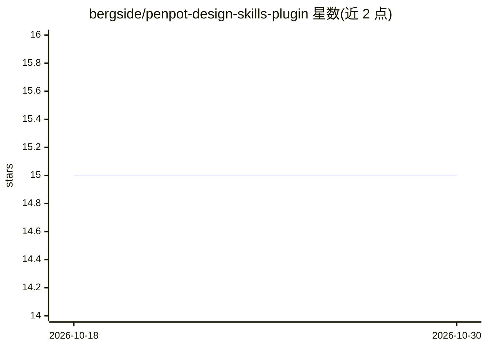

# bergside/penpot-design-skills-plugin

⭐ 15 · TypeScript · MIT · 推送 2026-04-09 · [GitHub](https://github.com/bergside/penpot-design-skills-plugin) · [官网](https://penpot.app/penpothub/plugins/design-md-skills) · 组织维护

**Penpot 插件：基于 TypeUI 生成设计系统 skill.md 文件**

运行在 Penpot 内的开源插件，面向使用 AI 编码工具的设计与开发团队：通过结构化表单录入品牌、使命、设计基础、可访问性与 QA 约束，配合颜色/间距/圆角/阴影/动效的 token 编辑器，基于 TypeUI manifest 生成一份通用的 skill.md 设计系统蓝图文件，供 Claude、Codex、Gemini、Cursor 等 AI 提供方使用。内置规则语言（must/should）、七种必需交互状态与质量检查，支持预览、复制与下载。MIT 许可。

## 筛选速览

| 维度 | 判定 | 备注 |
|---|---|---|
| AI 角色 | `ai-ecosystem` | LLM/agent 周边工具 |
| 许可风险 | `permissive` | MIT |
| 部署形态 | `library` | 以包/库形式分发 |
| 模型依赖 | — | README 未给出锁定关系 |
| 硬件要求 | — | 无带数字的原话,不猜 |
| 安装摩擦 | `low` | 无编译、无系统依赖或容器化 |
| 成熟度 | — | 结构信号不足 |

## 能力要点

- 基于 TypeUI manifest 生成通用 skill.md 文件
- 颜色/间距/圆角/阴影/动效的 token 编辑器
- must/should 规则语言与七种必需交互状态
- 必需章节与链接的质量检查，插件内预览/复制/下载

## 适用场景

- 把 Penpot 中的设计系统整理成 AI 可读的 skill 文件
- 为 Claude、Cursor 等 AI 工具提供设计规范上下文
- 在设计系统层面统一品牌、可访问性与 QA 约束的描述

## 场景标签

`提示工程` · 领域:Agent 开发

## 证据(README 行号)

> L3: Use this open-source plugin for Penpot to generate design skill files for AI providers such as Claude, Codex, Gemini
> L7: It generates a generic `skill.md` file that can be used by all major AI providers based on the TypeUI manifest.

## 星数曲线

2026-10-18 15 → 2026-10-30 15（+0）

---
*卡片 v1 · prompt 1.4 · 生成 2026-10-30 · 置信度 high · 依据 README sha `84d5ca9b2def` · [字段定义](../../DATASET.md)*
