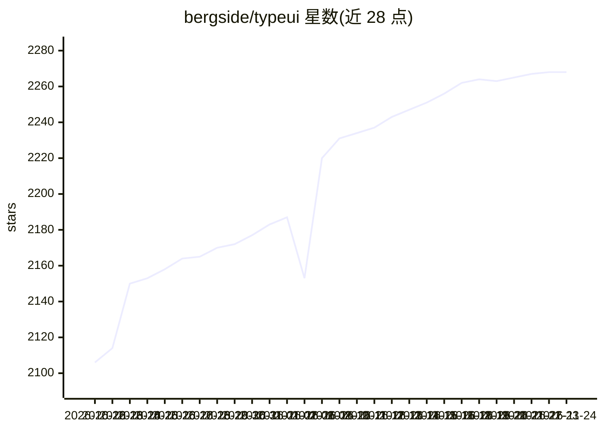

# bergside/typeui

⭐ 2,273 · TypeScript · NOASSERTION · 推送 2026-10-22 · [GitHub](https://github.com/bergside/typeui) · [官网](https://www.typeui.sh) · 组织维护

**给 AI 编码工具提供设计技能与 UI 提示词的资源库**

TypeUI 提供 AI 优先的 UI 设计资源集，包括 DESIGN.md/SKILL.md 两种格式的设计技能、17 类 UI 提示词（hero/pricing/faq 等，共约 160 个布局）以及 UI/UX 基础知识技能（间距、排版、对比度等）。通过 MCP 服务器接入 Claude、Codex、Cursor、VS Code 等约 25 种 AI 编码工具；资源声明可用于任何支持 markdown 或通用提示的 AI 提供方。README 未包含运行代码或完整安装命令，主要是指向 typeui.sh 各指南与技能页的链接索引。

## 筛选速览

| 维度 | 判定 | 备注 |
|---|---|---|
| AI 角色 | `ai-knowledge` | 知识聚合/清单类 |
| 许可风险 | `none` | NOASSERTION |
| 部署形态 | `library` | 以包/库形式分发 |
| 模型依赖 | — | README 未给出锁定关系 |
| 硬件要求 | — | 无带数字的原话,不猜 |
| 安装摩擦 | `low` | 无编译、无系统依赖或容器化 |
| 成熟度 | — | 结构信号不足 |

## 能力要点

- DESIGN.md 与 SKILL.md 双格式的设计技能（60+ 风格）
- 17 类 UI 提示词分类（hero/pricing/testimonial 等）
- 通过 MCP 服务器接入约 25 种 AI 编码工具
- UI/UX 基础原则技能（间距、排版、颜色对比）

## 适用场景

- 在 AI 编码工具中生成更符合设计规范的界面
- 为设计系统风格的 UI 生成选择预设技能
- 按布局类型查找现成的 UI 生成提示词

## 场景标签

`提示工程` · 领域:Agent 开发

## 证据(README 行号)

> L3: TypeUI is an AI-first platform where you can use design skills, UI prompts, and other resources to enhance AI capabi
> L241: Check out all design skills. Available in both `DESIGN.md` and `SKILL.md` formats.
> L583: Browse all major UI prompt categories from TypeUI Prompts.

## 星数曲线

2026-10-22 2,106 → 2026-11-24 2,268（+162）

---
*卡片 v1 · prompt 1.4 · 生成 2026-11-23 · 置信度 mid · 依据 README sha `2d6e647100a6` · [字段定义](../../DATASET.md)*
