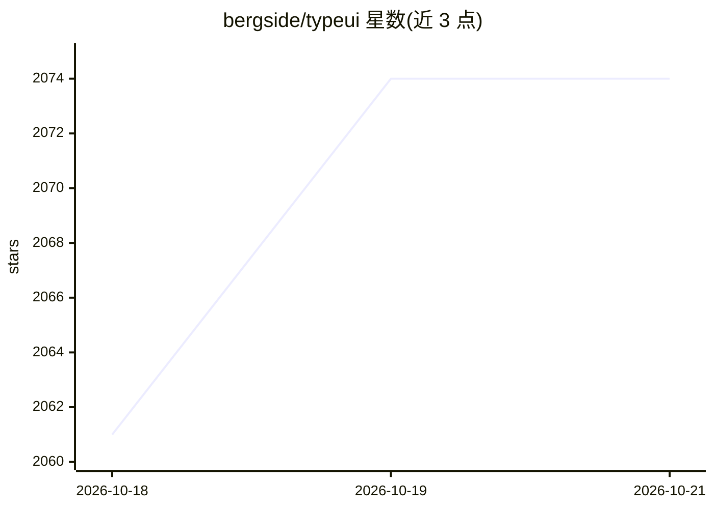

# bergside/typeui

⭐ 2,074 · TypeScript · NOASSERTION · 推送 2026-07-04 · [GitHub](https://github.com/bergside/typeui) · [官网](https://www.typeui.sh) · 组织维护

**给 AI 编码工具提供设计技能与 UI 提示词的资源平台**

面向用 AI 生成网站与应用界面的开发者：提供 90 余个设计风格技能（DESIGN.md 与 SKILL.md 双格式）、16 类 UI 提示词（Hero、定价、FAQ 等页面区块布局，附布局数量）以及 UI/UX 基础技能。通过 MCP 服务器或各工具插件接入 Codex、Claude、Cursor、Grok、Z.ai、VS Code、Windsurf 等 20 余种 AI 编码工具，用户以自然语言请求 UI，由资源引导生成。README 声明资源兼容任何支持 markdown 或通用提示的 AI 提供方。基础技能通过 npm 命令本地安装。

## 筛选速览

| 维度 | 判定 | 备注 |
|---|---|---|
| AI 角色 | `ai-knowledge` | 知识聚合/清单类 |
| 许可风险 | `none` | NOASSERTION |
| 部署形态 | `library` | 以包/库形式分发 |
| 模型依赖 | locked-api |  |
| 硬件要求 | — | 无带数字的原话,不猜 |
| 安装摩擦 | `low` | 无编译、无系统依赖或容器化 |
| 成熟度 | — | 结构信号不足 |

## 能力要点

- 90 余个设计风格技能，提供 DESIGN.md 与 SKILL.md 双格式
- 16 类 UI 提示词覆盖 Hero、定价、CTA、登录等页面区块
- 通过 MCP 或专属插件接入 20 余种 AI 编码工具
- UI/UX 基础技能约束间距、排版、对比度等设计原则

## 适用场景

- 为 AI 编码助手补充设计系统与布局指导
- 按风格（极简、玻璃拟态、新粗野主义等）生成界面
- 获取各类页面区块的多种布局变体提示词

## 场景标签

`提示工程` · 领域:Agent 开发

## 证据(README 行号)

> L3: TypeUI is an AI-first platform where you can use design skills, UI prompts, and other resources to enhance AI capabi
> L7: Install TypeUI where you build. Connect your AI coding tool to TypeUI MCP, then ask for UI in plain language while T
> L241: Check out all design skills. Available in both `DESIGN.md` and `SKILL.md` formats.

## 星数曲线

2026-10-18 2,061 → 2026-10-21 2,074（+13）

---
*卡片 v1 · prompt 1.4 · 生成 2026-10-21 · 置信度 high · 依据 README sha `746110453b50` · [字段定义](../../DATASET.md)*
