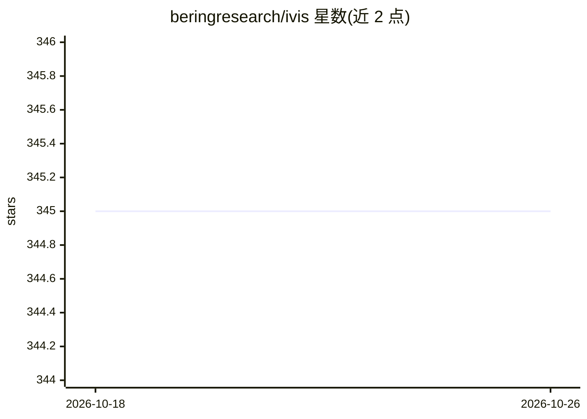

# beringresearch/ivis

⭐ 345 · Python · Apache-2.0 · 推送 2025-11-10 · [GitHub](https://github.com/beringresearch/ivis) · [官网](https://beringresearch.github.io/ivis/) · 组织维护

**用孪生网络对超大规模数据做降维可视化的 Python 库**

论文 Structure-preserving visualisation of high dimensional single-cell datasets 所述 ivis 算法的实现：用基于三元组训练的孪生神经网络对高维数据降维，支持无监督与监督模式，可扩展到百万级样本。输入支持 numpy 数组、稀疏矩阵与 hdf5 文件，通过 transform 方法可将新数据点加入已有嵌入并接入 sklearn Pipeline。构建于 TensorFlow 之上，提供 CPU/GPU 两种 pip 安装选项。由 Bering Limited 版权所有。

## 筛选速览

| 维度 | 判定 | 备注 |
|---|---|---|
| AI 角色 | `ai-native` | 本体是模型或模型工具 |
| 许可风险 | `permissive` | Apache-2.0 |
| 部署形态 | `library` | 以包/库形式分发 |
| 模型依赖 | — | README 未给出锁定关系 |
| 硬件要求 | — | 无带数字的原话,不猜 |
| 安装摩擦 | `medium` | 含编译或系统依赖之一 |
| 成熟度 | — | 结构信号不足 |

## 能力要点

- 孪生神经网络三元组训练，支持无监督与监督模式
- 支持 numpy 数组、稀疏矩阵、hdf5 输入及类别/连续特征
- transform 方法可将新数据点映射到已有嵌入，兼容 sklearn Pipeline
- 提供 CPU 与 GPU 两种 pip 安装变体

## 适用场景

- 对百万级样本的高维数据做降维可视化
- 单细胞数据的保结构降维
- 降维结果用于聚类或异常检测

## 场景标签

`数据分析` · 领域:效率与自动化

## 证据(README 行号)

> L5: Implementation of the ivis algorithm as described in the paper Structure-preserving visualisation of high dimensiona
> L11: Ivis runs on top of TensorFlow. To install the latest ivis release from PyPi running on the CPU TensorFlow package,

## 星数曲线

2026-10-18 345 → 2026-10-26 345（+0）

---
*卡片 v1 · prompt 1.4 · 生成 2026-10-21 · 置信度 high · 依据 README sha `835a04695192` · [字段定义](../../DATASET.md)*
