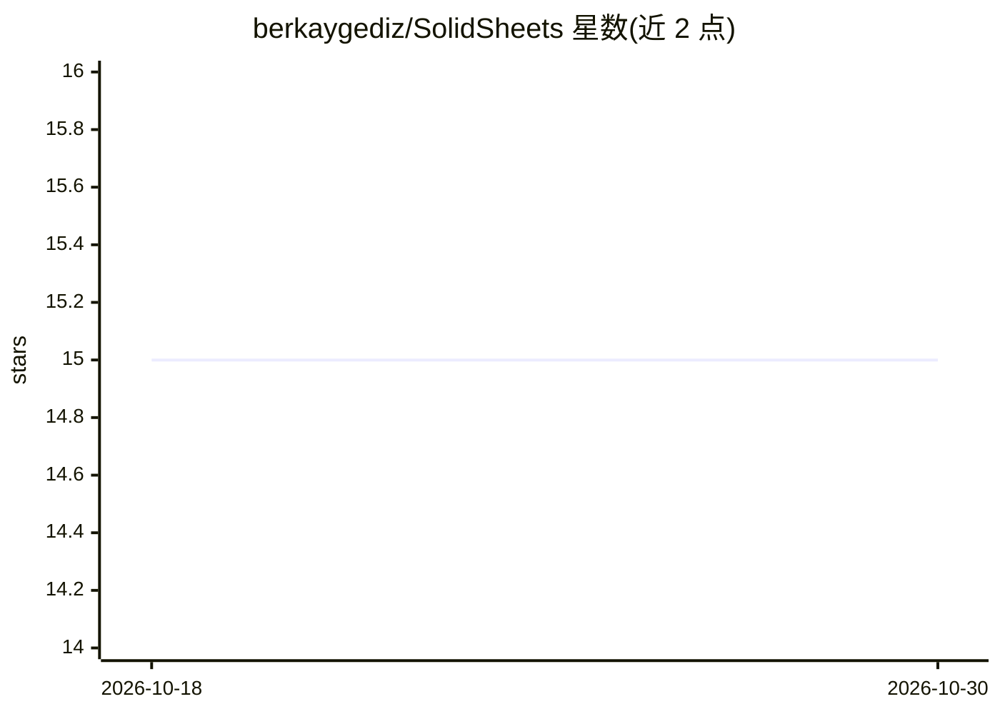

# berkaygediz/SolidSheets

⭐ 15 · Python · GPL-3.0 · 推送 2026-05-13 · [GitHub](https://github.com/berkaygediz/SolidSheets) · 个人维护

**带机器学习功能的跨平台电子表格编辑器**

基于 Python/PySide6 的桌面电子表格应用，支持打开、编辑与打印 CSV、SSFS/SSFS64 及 XLSX（部分）文件；提供公式函数（avg/sum/min/max 等）、图表（饼图/柱状图/直方图等）、实时行列统计、15 种语言界面与深浅色模式。机器学习部分集成了基于 statsmodels 的线性回归算法。跨平台支持 Windows，macOS 与 Linux 为实验性。通过 git clone 源码安装并用 python 运行，可用 pyinstaller 打包。

## 筛选速览

| 维度 | 判定 | 备注 |
|---|---|---|
| AI 角色 | `ai-enhanced` | 去掉 AI 部分产品仍成立 |
| 许可风险 | `viral` | GPL-3.0 |
| 部署形态 | `library` | 以包/库形式分发 |
| 模型依赖 | — | README 未给出锁定关系 |
| 硬件要求 | — | 无带数字的原话,不猜 |
| 安装摩擦 | `low` | 无编译、无系统依赖或容器化 |
| 成熟度 | `idea` | |

## 能力要点

- 支持 CSV、SSFS/SSFS64、XLSX（部分）文件读写与 PDF 导出
- 内置线性回归机器学习算法
- 图表函数：饼图/柱状图/直方图/散点图等
- 15 种语言界面，Windows/macOS/Linux 跨平台（后两者实验性）

## 适用场景

- 日常打开和编辑 CSV/XLSX 表格数据
- 在表格内使用公式与图表分析数据
- 对表格数据做线性回归分析

## 场景标签

`数据分析` · 领域:效率与自动化

## 证据(README 行号)

> L9: SolidSheets offers a user-friendly interface and powerful features to manage and analyze your data. Easily open, edi
> L13: - [x] **File Operations**: Open and save CSV, SSFS/SSFS64 (SolidSheets Files) & XLSX (partial).
> L24: - [x] **Machine Learning**: Integrated machine learning algorithms for linear regression.

## 星数曲线

2026-10-18 15 → 2026-10-30 15（+0）

---
*卡片 v1 · prompt 1.4 · 生成 2026-10-30 · 置信度 mid · 依据 README sha `bbfb5572aab6` · [字段定义](../../DATASET.md)*
