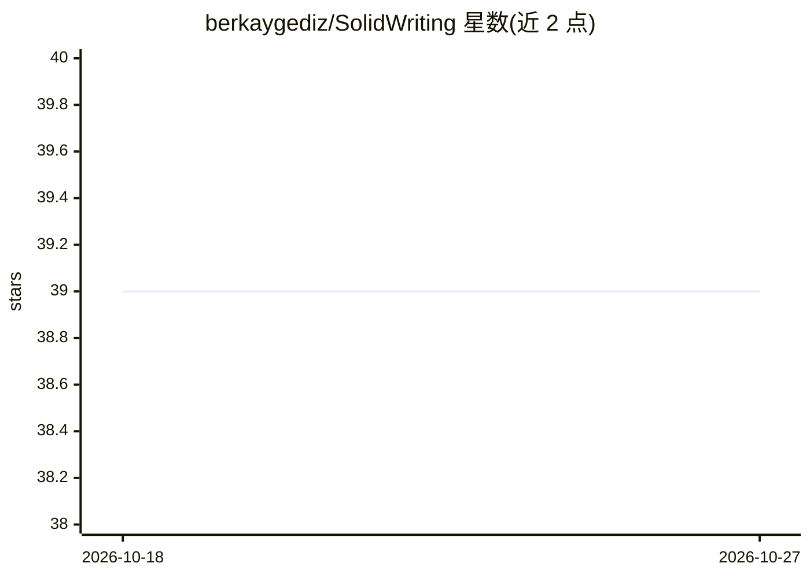

# berkaygediz/SolidWriting

⭐ 39 · Python · GPL-3.0 · 推送 2026-05-13 · [GitHub](https://github.com/berkaygediz/SolidWriting) · 个人维护

**带离线 AI 助手的跨平台文字处理器**

基于 Python/PySide6 的跨平台（Windows，macOS/Linux 实验性）文字处理器，支持创建、编辑与保存 SWDOC/SWDOC64 及 DOCX（部分）文件，提供文本格式化、查找替换、PDF 导出、表格、超链接、多语言界面（14 种语言）等功能。AI 部分为内置离线聊天助手，用于内容生成与问答，依赖 llama-cpp-python 与 torch 实现本地运行。安装方式为克隆源码并 pip 安装依赖，可经 pyinstaller 打包。macOS/Linux 支持标注为实验性。

## 筛选速览

| 维度 | 判定 | 备注 |
|---|---|---|
| AI 角色 | `ai-enhanced` | 去掉 AI 部分产品仍成立 |
| 许可风险 | `viral` | GPL-3.0 |
| 部署形态 | `library` | 以包/库形式分发 |
| 模型依赖 | — | README 未给出锁定关系 |
| 硬件要求 | — | 无带数字的原话,不猜 |
| 安装摩擦 | `low` | 无编译、无系统依赖或容器化 |
| 成熟度 | `idea` | |

## 能力要点

- 离线 AI 助手：内容生成与问答，本地运行（llama-cpp-python/torch）
- 自研 SWDOC/SWDOC64 格式与 DOCX（部分）支持
- 14 种界面语言与 PDF 导出、表格、超链接等编辑功能

## 适用场景

- 日常文档撰写并使用离线 AI 辅助生成内容与答疑
- 不依赖云端服务的本地文档编辑
- 跨平台（Windows/macOS/Linux）办公文档处理

## 场景标签

`AI 助手` `AI 写作` · 领域:对话与助手

## 证据(README 行号)

> L15: SolidWriting offers an intuitive interface and powerful features for creating and editing documents. Easily open, e
> L35: - [x] **Offline AI Chat**: Built-in AI assistant (offline mode) for content generation & Q&A, with automatic langua

## 星数曲线

2026-10-18 39 → 2026-10-27 39（+0）

---
*卡片 v1 · prompt 1.4 · 生成 2026-10-25 · 置信度 high · 依据 README sha `bbaac2dddd92` · [字段定义](../../DATASET.md)*
