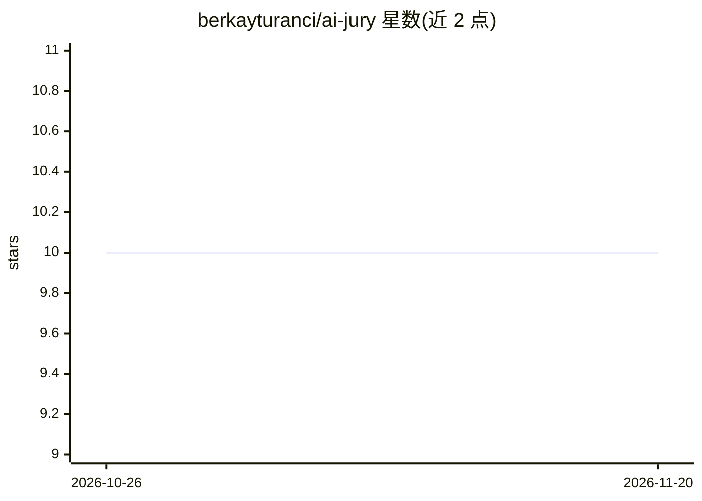

# berkayturanci/ai-jury

⭐ 10 · Python · MIT · 推送 2026-11-16 · [GitHub](https://github.com/berkayturanci/ai-jury) · [官网](https://ai-jury.dev) · 个人维护

**多供应商 AI 评审团 CLI：多 agent 交叉评审 PR/diff 出裁定**

仅依赖标准库的 Python CLI，将多种 AI agent 供应商（原生 CLI agent、托管 API、本地开源权重模型、任意编码 agent CLI）编排为多 agent 代码评审团：同一 diff/PR/issue 独立评审、相互质证、验证发现，最终由主席综合或面板投票产出裁定。评审者以沙盒只读方式无头运行，无需访问代码仓库；支持 jury init 配置检测、CI 门控、增量评审、补丁建议与大 diff 分块。需 Python 3.11+，PR/issue 功能另需 gh。

## 筛选速览

| 维度 | 判定 | 备注 |
|---|---|---|
| AI 角色 | `ai-ecosystem` | LLM/agent 周边工具 |
| 许可风险 | `permissive` | MIT |
| 部署形态 | `library` | 以包/库形式分发 |
| 模型依赖 | local-ok | 支持本地模型 |
| 硬件要求 | — | 无带数字的原话,不猜 |
| 安装摩擦 | `medium` | 含编译或系统依赖之一 |
| 成熟度 | — | 结构信号不足 |

## 能力要点

- 通用 agent 供应商接入：云 CLI、托管 API（含 OpenAI 兼容接口）、本地模型、任意编码 agent CLI
- 多轮对抗式辩论 + 主席验证或面板投票产出裁定
- 评审者默认沙盒只读运行，无需仓库访问权限
- 提供 PR/issue/diff 评审、--mock 离线演示、GitHub Action 与 pre-commit hook 集成

## 适用场景

- 在 CI 中对 PR 做多模型交叉评审并按结果门控合并
- 混合使用云端 CLI、托管 API 与免费本地模型评审代码变更
- 对 issue 做完整性与清晰度判定（READY/NEEDS-INFO/UNCLEAR）
- 通过 pre-commit hook 在提交前触发评审

## 场景标签

`代码审查` `多智能体` · 领域:Agent 开发

## 证据(README 行号)

> L17: Most "multi-model review" tools call models at the **API level**. This one drives **any AI agent provider**: vendor
> L25: Highlights: **universal agent provider support** (cloud CLIs, hosted APIs, local models, arbitrary CLI agents) · **

## 星数曲线

2026-10-26 10 → 2026-11-20 10（+0）

---
*卡片 v1 · prompt 1.4 · 生成 2026-11-19 · 置信度 mid · 依据 README sha `8c5a67486424` · [字段定义](../../DATASET.md)*
