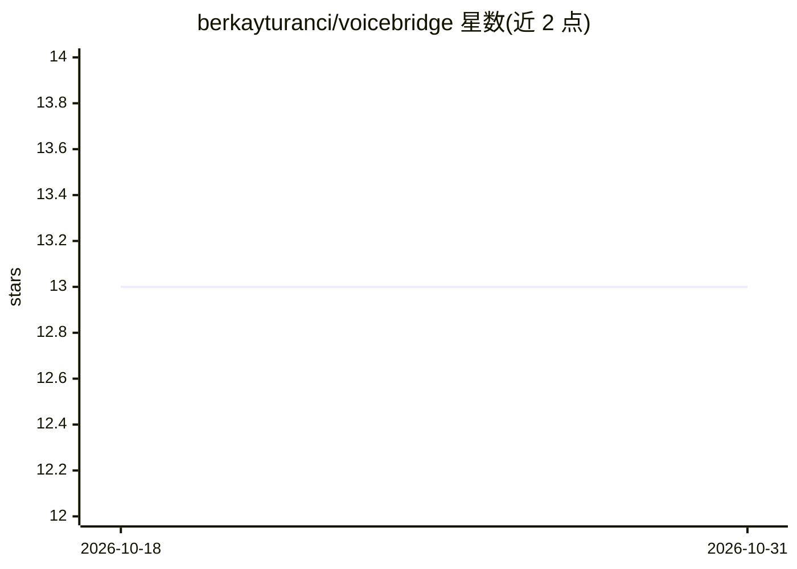

# berkayturanci/voicebridge

⭐ 13 · JavaScript · NOASSERTION · 推送 2026-10-26 · [GitHub](https://github.com/berkayturanci/voicebridge) · [官网](https://berkayturanci.github.io/voicebridge/) · 个人维护

**手机语音双向操控本地编程 agent 的自托管桥接应用**

在手机浏览器与电脑上的编程 agent CLI（Claude Code、Codex、Antigravity、Ollama、Aider、Gemini CLI）之间建立语音/文字双向通道：手机端语音输入经 Web Speech 或本地 Whisper 转写，回复逐句流式合成语音；通过 Node 桥接服务与 Tailscale HTTPS 私有网络通信，支持多会话并行、工具审批卡片、Git diff 查看与会话导出。提供 Mac DMG 与 Windows 预览安装包，也可 npm 源码运行；Ollama 后端可全本地，非商业用途免费（PolyForm Noncommercial）。

## 筛选速览

| 维度 | 判定 | 备注 |
|---|---|---|
| AI 角色 | `ai-ecosystem` | LLM/agent 周边工具 |
| 许可风险 | `none` | NOASSERTION |
| 部署形态 | `desktop` | 安装包/桌面程序 |
| 模型依赖 | local-ok | 支持本地模型 |
| 硬件要求 | — | 无带数字的原话,不猜 |
| 安装摩擦 | `medium` | 含编译或系统依赖之一 |
| 成熟度 | `idea` | |

## 能力要点

- 6 种编程 agent CLI 接入，按会话选择与自主模式切换
- 浏览器 Web Speech 语音转写 + 本地 Whisper（批量/流式）可选，TTS 全程在设备端
- Tailscale HTTPS 私有网络暴露 + 可选共享访问令牌，不经第三方语音服务
- 多设备 WebSocket 实时同步、手机端工具审批与 Git diff 查看

## 适用场景

- 离开键盘时用手机语音与电脑上的 Claude Code/Aider 等对话式编程
- 在多台设备上并行查看与操控不同 agent 会话
- 手机上一键批准/拒绝 agent 的命令与工具调用

## 场景标签

`语音 Agent` `编码 Agent` · 领域:编码与开发

## 证据(README 行号)

> L25: - 🤖 **6 supported agents** — **Claude Code**, **Codex**, **Antigravity**, **Ollama** (fully local), **Aider**, and 
> L33: - 🎙️ **Speech-to-text** — runs in your phone's browser by default, or through your own local Whisper CLI (`STT_MODE
> L39: > cloud (that's how those CLIs work); with the **Ollama** backend the model runs

## 星数曲线

2026-10-18 13 → 2026-10-31 13（+0）

---
*卡片 v1 · prompt 1.4 · 生成 2026-10-31 · 置信度 high · 依据 README sha `c0de2deb798c` · [字段定义](../../DATASET.md)*
