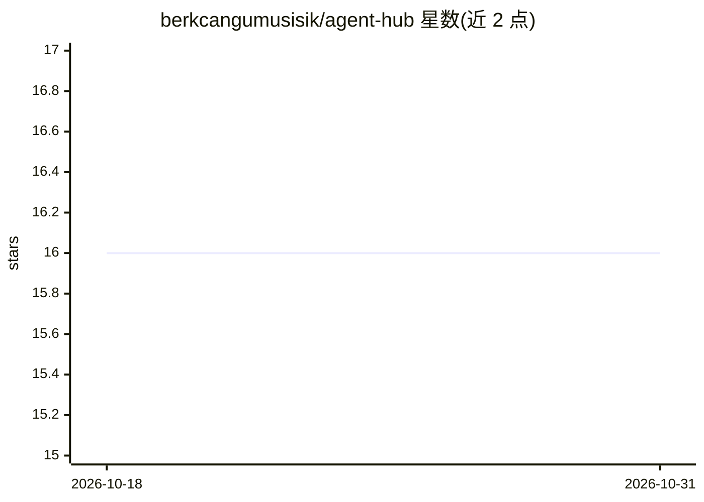

# berkcangumusisik/agent-hub

⭐ 16 · TypeScript · MIT · 推送 2026-06-26 · [GitHub](https://github.com/berkcangumusisik/agent-hub) · 个人维护 · 中文 README

**跨编码 agent 工具的 12 角色专家团队配置系统**

为 Claude Code、Codex、Cursor、Gemini CLI 等多种 AI 编码 harness 安装一套 12 角色专家团队（tech-lead、architect、code-reviewer 等）。每个项目通过 profile.yml 声明技术栈，agent 读取 profile 后按该项目惯用方式行动；决策以 ADR 形式记录并被团队遵守。Claude Code 上以插件形式提供真正的并行 subagent，其他工具生成 AGENTS.md 等规则文件；adapters/ 目录从单一源生成各 harness 文件。一行 curl 或 PowerShell 脚本安装。

## 筛选速览

| 维度 | 判定 | 备注 |
|---|---|---|
| AI 角色 | `ai-ecosystem` | LLM/agent 周边工具 |
| 许可风险 | `permissive` | MIT |
| 部署形态 | `library` | 以包/库形式分发 |
| 模型依赖 | — | README 未给出锁定关系 |
| 硬件要求 | — | 无带数字的原话,不猜 |
| 安装摩擦 | `low` | 无编译、无系统依赖或容器化 |
| 成熟度 | — | 结构信号不足 |

## 能力要点

- 12 角色专家团队，tech-lead 负责任务分解与路由
- 读取每项目 profile.yml 自动适配技术栈
- 决策记录为 ADR，团队跨会话遵守
- 单一源生成 8+ harness 的规则文件（AGENTS.md/CLAUDE.md/GEMINI.md 等）

## 适用场景

- 在多个 AI 编码工具间共用同一套专家团队配置
- 让 agent 自动识别项目技术栈并按其惯用方式工作
- 通过 code-reviewer/security-reviewer 做内置质量把关
- 以 ADR 形式保存并复用项目决策记录

## 场景标签

`多智能体` `编码 Agent` · 领域:Agent 开发

## 证据(README 行号)

> L7: **Not just configs — a system.** Install once and every project gets a 12-role specialist
> L9: Works across **Claude Code, Codex, Cursor, OpenCode, Gemini, Windsurf, GitHub Copilot, Cline,
> L78: |**Claude Code**|Plugin with 12 real subagents + `CLAUDE.md`|

## 星数曲线

2026-10-18 16 → 2026-10-31 16（+0）

---
*卡片 v1 · prompt 1.4 · 生成 2026-10-30 · 置信度 mid · 依据 README sha `7d6c22019615` · [字段定义](../../DATASET.md)*
