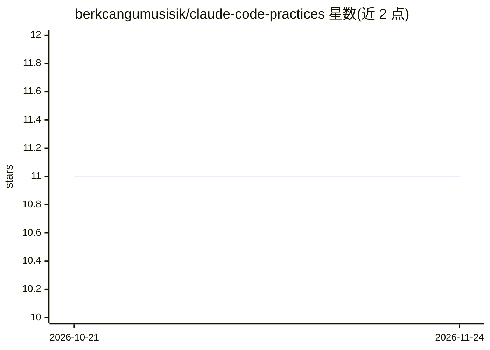

# berkcangumusisik/claude-code-practices

⭐ 11 · Shell · MIT · 推送 2026-04-19 · [GitHub](https://github.com/berkcangumusisik/claude-code-practices) · 个人维护

**为 Claude Code 用户降低 token 消耗的实践手册与技能集**

一份 Claude Code 使用实践手册：核心内容为 82 个可直接复制到 .claude/skills/ 的斜杠命令技能、提示词模板、CLAUDE.md 示例、settings.json hook 片段及速查表。围绕具体提示、带指令的 /compact、.claudeignore 三个技巧给出降低 token 消耗的流程。通过 curl 脚本或 git clone 手动复制安装。面向使用 Claude Code 的开发者，README 声明模式与具体模型无关。

## 筛选速览

| 维度 | 判定 | 备注 |
|---|---|---|
| AI 角色 | `ai-knowledge` | 知识聚合/清单类 |
| 许可风险 | `permissive` | MIT |
| 部署形态 | `None` |  |
| 模型依赖 | — | README 未给出锁定关系 |
| 硬件要求 | — | 无带数字的原话,不猜 |
| 安装摩擦 | `low` | 无编译、无系统依赖或容器化 |
| 成熟度 | — | 结构信号不足 |

## 能力要点

- 82 个跨 Git、测试、前后端、安全、数据库等类别的斜杠命令技能
- 提供 Next/React/Django/Go/Rust 框架的 CLAUDE.md 模板库
- 一键安装脚本支持 --all 与按名挑选技能
- 含 .claudeignore 配置片段与 hook 配方

## 适用场景

- 减少 Claude Code 会话中的 token 开销
- 快速为新项目搭建 CLAUDE.md 与技能库
- 团队将技能与 CLAUDE.md 提交到仓库共享

## 场景标签

`提示工程` `编码 Agent` · 领域:Agent 开发

## 证据(README 行号)

> L3: ### A field-tested playbook for using Claude Code without burning tokens.
> L59: #### Skill Library →
> L60: **82 ready-made slash commands.**

## 星数曲线

2026-10-21 11 → 2026-11-24 11（+0）

---
*卡片 v1 · prompt 1.4 · 生成 2026-11-18 · 置信度 high · 依据 README sha `484f0fe1ffce` · [字段定义](../../DATASET.md)*
