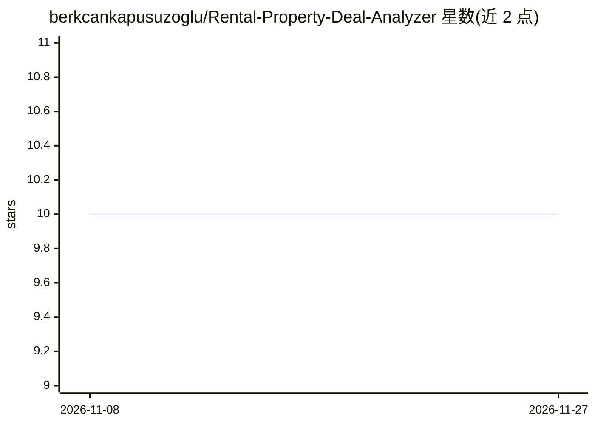

# berkcankapusuzoglu/Rental-Property-Deal-Analyzer

⭐ 10 · HTML · MIT · 推送 2026-03-23 · [GitHub](https://github.com/berkcankapusuzoglu/Rental-Property-Deal-Analyzer) · [官网](https://rental-property-deal-analyzer.onrender.com) · 个人维护

**给房产投资者的出租房投资测算工具，含 AI 分析**

基于 Python/FastAPI 的出租物业投资计算器：6 步向导录入物业、融资、收入与支出，实时计算 20+ 指标（CoC、Cap Rate、DSCR、NOI、GRM 等），配合 14 分制评分卡、5 年总回报拆解、4 种策略适配和敏感性分析表。AI 部分通过 LM Studio/Ollama 本地模型或 Anthropic Claude API 生成交易分析，可在多模型间切换。支持从 Zillow/Redfin 列表 URL 抓取数据自动填表、区域房源搜索评分，本地运行需安装 Playwright Chromium；在线演示仅支持手动录入的单一物业模式。

## 筛选速览

| 维度 | 判定 | 备注 |
|---|---|---|
| AI 角色 | `ai-native` | 本体是模型或模型工具 |
| 许可风险 | `permissive` | MIT |
| 部署形态 | `library` | 以包/库形式分发 |
| 模型依赖 | local-ok | 支持本地模型 |
| 硬件要求 | — | 无带数字的原话,不猜 |
| 安装摩擦 | `low` | 无编译、无系统依赖或容器化 |
| 成熟度 | — | 结构信号不足 |

## 能力要点

- 20+ 投资指标即时计算与 14 分制评分卡
- AI 分析支持 LM Studio/Ollama 本地模型或 Claude API，可切换模型
- Zillow/Redfin 列表 URL 自动抓取填表，Redfin 租金估算
- 4 张敏感性分析 what-if 表与 5 年回报拆解

## 适用场景

- 买房前快速测算现金流、回报率等指标判断是否值得买
- 用 AI 生成对某笔房产交易的逐项分析
- 按邮编/城市搜索房源并按投资指标排序筛选
- 对比最多 3 个方案并导出 PDF/HTML 报告

## 场景标签

`网页抓取` · 领域:效率与自动化

## 证据(README 行号)

> L5: Free, open-source rental property investment calculator with AI-powered analysis.
> L22: - **20+ investment metrics** calculated instantly (CoC, Cap Rate, DSCR, NOI, GRM, and more)
> L23: - **AI-powered analysis** — free local models or Claude API

## 星数曲线

2026-11-08 10 → 2026-11-27 10（+0）

---
*卡片 v1 · prompt 1.4 · 生成 2026-11-19 · 置信度 high · 依据 README sha `efb945f10abd` · [字段定义](../../DATASET.md)*
