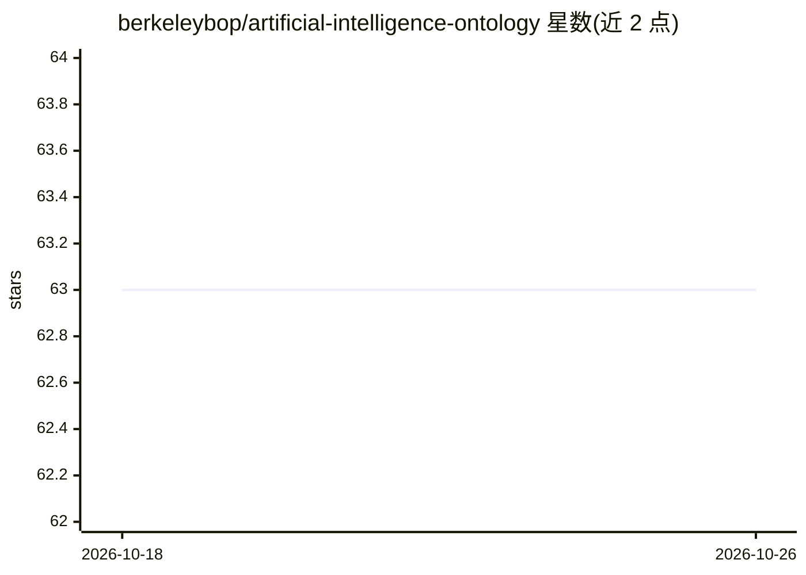

# berkeleybop/artificial-intelligence-ontology

⭐ 63 · Jupyter Notebook · NOASSERTION · 推送 2026-09-25 · [GitHub](https://github.com/berkeleybop/artificial-intelligence-ontology) · [官网](https://berkeleybop.github.io/artificial-intelligence-ontology/) · 组织维护

**描述 AI/ML 概念与偏见的本体：建模网络、层与任务分类体系**

Berkeleybop 维护的人工智能本体（AIO）：以 OWL 形式对深度学习网络、组成层与激活函数、机器学习方法以及 AI/ML 潜在偏见等概念建模类与关系。提供稳定发布版 aio.owl 与编辑版 src/ontology/aio-edit.owl，并含与上层本体（BFO/IAO/OBI）的桥接公理，将 Bias、Layer、Model、MachineLearningTask 等类映射到 OBO 术语。本体可经项目网站与 BioPortal 浏览，仓库由 Ontology Development Kit 创建。README 未给出安装命令。

## 筛选速览

| 维度 | 判定 | 备注 |
|---|---|---|
| AI 角色 | `ai-knowledge` | 知识聚合/清单类 |
| 许可风险 | `none` | NOASSERTION |
| 部署形态 | `None` |  |
| 模型依赖 | — | README 未给出锁定关系 |
| 硬件要求 | — | 无带数字的原话,不猜 |
| 安装摩擦 | `low` | 无编译、无系统依赖或容器化 |
| 成熟度 | — | 结构信号不足 |

## 能力要点

- 以 OWL 建模深度学习网络、层、激活函数与 ML 方法等类及关系
- 提供与 BFO/IAO/OBI 等上层本体的桥接公理
- 稳定版 aio.owl 与编辑版 aio-edit.owl 两种发布形态
- 可在 BioPortal 上浏览

## 适用场景

- 为 AI/ML 领域数据或系统提供标准化术语与语义标注
- 在知识图谱中复用 AI 概念分类体系并与 OBO 本体对齐
- 查阅 AI/ML 相关偏见等概念的规范定义

## 场景标签

`知识图谱` · 领域:知识与检索

## 证据(README 行号)

> L1: # Artificial Intelligence Ontology (AIO)
> L3: An ontology modeling classes and relationships describing deep learning networks, their component layers and activat

## 星数曲线

2026-10-18 63 → 2026-10-26 63（+0）

---
*卡片 v1 · prompt 1.4 · 生成 2026-10-24 · 置信度 high · 依据 README sha `27f4519986d3` · [字段定义](../../DATASET.md)*
