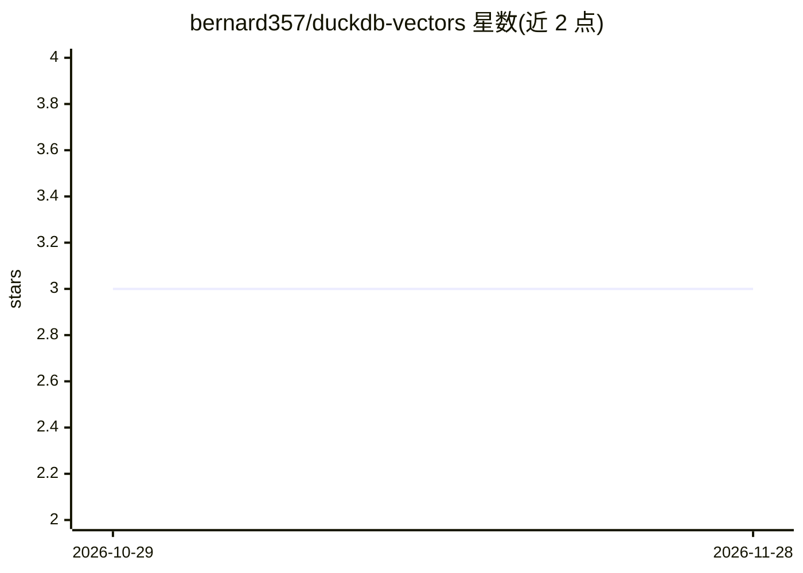

# bernard357/duckdb-vectors

⭐ 3 · Python · MIT · 推送 2026-11-27 · [GitHub](https://github.com/bernard357/duckdb-vectors) · [官网](https://bernard357.github.io/duckdb-vectors/) · 个人维护

**面向 agent 系统的嵌入式本地语义检索构建块**

duckdb-vectors 是一个 Python 包，为 agent 系统提供小规模语义检索能力：将 Markdown/PDF 切块并把嵌入存入单个 DuckDB 文件，再把该文件打包进 agent 容器镜像，查询时以本地函数调用完成向量余弦扫描与 BM25 精确词元扫描的混合检索（RRF 融合），默认不建 ANN 索引。嵌入默认在本地进程内运行，云端嵌入为可选项。可通过 `mcp` 子命令以 stdio 形式向 MCP 客户端提供 `search` 与 `report` 工具，从 PyPI 安装。

## 筛选速览

| 维度 | 判定 | 备注 |
|---|---|---|
| AI 角色 | `ai-ecosystem` | LLM/agent 周边工具 |
| 许可风险 | `permissive` | MIT |
| 部署形态 | `self-host` | docker 或自建部署 |
| 模型依赖 | — | README 未给出锁定关系 |
| 硬件要求 | — | 无带数字的原话,不猜 |
| 安装摩擦 | `low` | 无编译、无系统依赖或容器化 |
| 成熟度 | — | 结构信号不足 |

## 能力要点

- 向量余弦扫描与 BM25 经 RRF 融合的混合检索，查询为进程内本地调用
- 单 DuckDB 文件即索引，以只读方式烘焙进 agent 容器镜像，查询路径无网络跳
- 嵌入后端按字符串选择：默认本地 256 维多语言静态模型，支持 fastembed 维度阶梯、Hugging Face ONNX 仓库与 Bedrock Titan
- 以 stdio MCP 服务器形式被 Claude Desktop、Claude Code、Cursor 等客户端调用

## 适用场景

- 把本地几千篇静态文档变成 agent 的 RAG 检索能力
- 为 agent 建一个按语义搜索选取技能的技能注册表
- 在 MCP 编辑器中接入自己的知识库，检索不出本地
- 把 docx/pptx 等 Office 文档转成 Markdown 后索引检索

## 场景标签

`RAG` `语义搜索` `向量数据库` · 领域:知识与检索

## 证据(README 行号)

> L12: `duckdb-vectors` is a python package that facilitates the implementation of small-scale semantic search into any ki
> L24: For the common case — a few thousand documents, read-mostly, packaged with one agent — you can skip the external ve
> L71: The `mcp` verb turns the package into a Model Context Protocol tool: any MCP client (Docker Agent, Claude Desktop, 

## 星数曲线

2026-10-29 3 → 2026-11-28 3（+0）

---
*卡片 v1 · prompt 1.4 · 生成 2026-11-22 · 置信度 mid · 依据 README sha `4a7e3b951134` · [字段定义](../../DATASET.md)*
