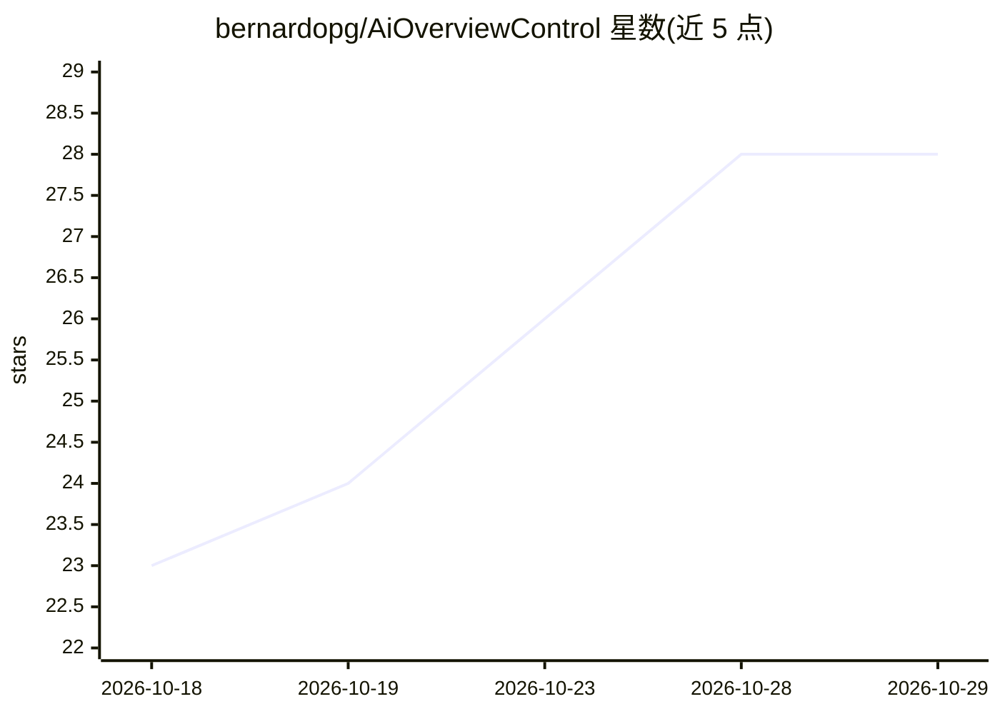

# bernardopg/AiOverviewControl

⭐ 28 · Shell · MIT · 推送 2026-10-27 · [GitHub](https://github.com/bernardopg/AiOverviewControl) · [官网](https://duxlabs.dev/plugins) · 个人维护 · 中文 README

**Dank Material Shell 插件：在桌面栏统一查看 39 家 AI 服务的配额与用量**

Qt/Quickshell 编写的 DankMaterialShell（DMS）插件，面向 Linux 桌面（Hyprland/niri 等）用户：本地读取 39 家 AI 提供商的配额、余额、认证状态与本地用量数据，在 DankBar 以 pill 与仪表盘形式展示，按覆盖类型分为配额/余额/分析/认证/本地运行时/信息性六类。Claude、9Router、pi、Hermes 等额外读取磁盘上已有数据提供 token、成本、模型的七日图表。支持配额阈值桌面通知、五语言界面（含简体中文），密钥不显示且仅发往各官方 API。需 DMS 2.0+，默认集合依赖 bash/jq/curl/codex/claude/gh。

## 筛选速览

| 维度 | 判定 | 备注 |
|---|---|---|
| AI 角色 | `ai-enhanced` | 去掉 AI 部分产品仍成立 |
| 许可风险 | `permissive` | MIT |
| 部署形态 | `None` |  |
| 模型依赖 | local-ok | 支持本地模型 |
| 硬件要求 | — | 无带数字的原话,不猜 |
| 安装摩擦 | `low` | 无编译、无系统依赖或容器化 |
| 成熟度 | — | 结构信号不足 |

## 能力要点

- 39 家 AI 提供商的配额/余额/认证状态聚合为单一仪表盘
- 从磁盘本地数据读取 Claude 等的 token、成本、模型七日分析，支持多 Claude 账号
- 75/85/95% 或按提供商阈值的桌面配额提醒
- 密钥不展示、不调用付费端点测试密钥，凭据只发往对应官方 API

## 适用场景

- 在桌面栏一眼查看各 AI 订阅还剩多少额度、何时重置
- 多 Claude 账号或多提供商并排对比用量与成本
- 配额接近上限时收到桌面通知避免意外断供

## 场景标签

 · 领域:Linux 桌面工具/AI 用量监控

## 证据(README 行号)

> L7: A DankMaterialShell plugin that tracks
> L33: You pay for Claude, Codex, Copilot, OpenRouter… and each one hides its quota in a
> L116: |**Local runtime**|Local models and sessions|Ollama, Vertex AI|

## 星数曲线

2026-10-18 23 → 2026-10-29 28（+5）

---
*卡片 v1 · prompt 1.4 · 生成 2026-10-26 · 置信度 high · 依据 README sha `64a7842092e5` · [字段定义](../../DATASET.md)*
