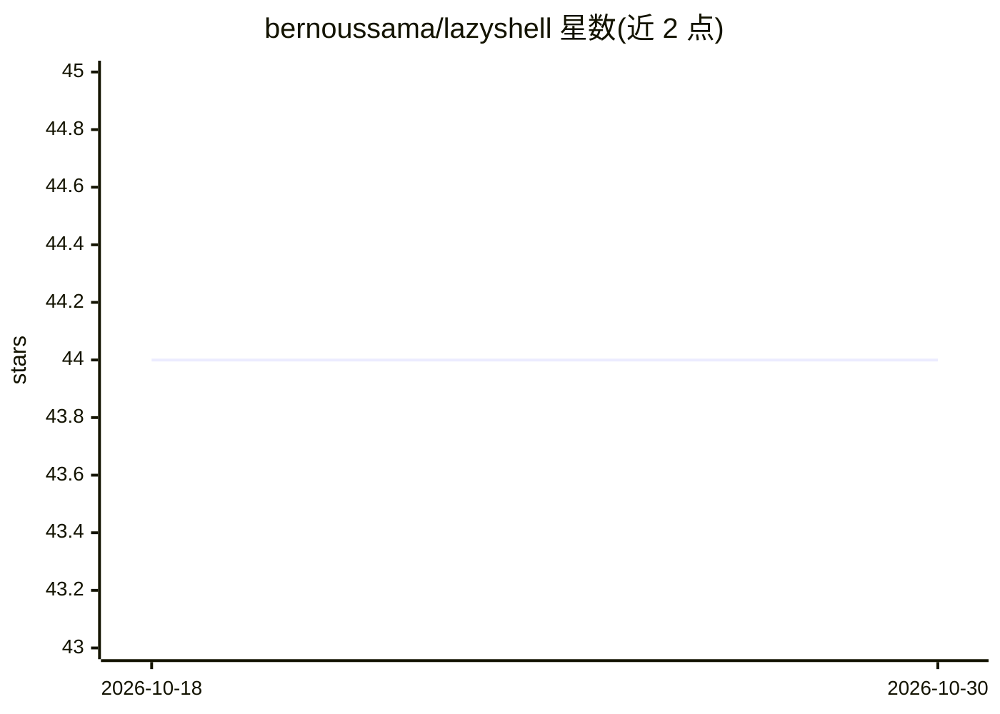

# bernoussama/lazyshell

⭐ 44 · TypeScript · MIT · 推送 2026-09-13 · [GitHub](https://github.com/bernoussama/lazyshell) · 个人维护

**自然语言生成并执行 shell 命令的 AI CLI 助手**

命令行工具，读取自然语言描述生成对应 shell 命令，经确认后执行并复制到剪贴板。支持 Groq、Gemini、OpenRouter、Anthropic、OpenAI、Ollama、Mistral、LM Studio 等多种提供方，也可选装约 469 MB 的 Qwen2.5-Coder 0.5B GGUF 本地模型（无 Ollama 时可自动启动 llama-server）。自动检测 OS、发行版、包管理器与 shell 以生成适配命令。内置评测系统（ExactMatch/Levenshtein/LLMJudge）、多模型基准测试与 CI 质量门禁。经 npm/yarn/pnpm/bun 或安装脚本安装。

## 筛选速览

| 维度 | 判定 | 备注 |
|---|---|---|
| AI 角色 | `ai-native` | 本体是模型或模型工具 |
| 许可风险 | `permissive` | MIT |
| 部署形态 | `library` | 以包/库形式分发 |
| 模型依赖 | local-ok | 支持本地模型 |
| 硬件要求 | — | 无带数字的原话,不猜 |
| 安装摩擦 | `low` | 无编译、无系统依赖或容器化 |
| 成熟度 | `idea` | |

## 能力要点

- 自然语言转 shell 命令，确认后执行并自动复制到剪贴板
- 支持 7+ 云端提供方及 Ollama/LM Studio/捆绑 GGUF 本地模型
- 自动检测 OS、发行版、包管理器与 shell 生成系统适配命令
- 内置评测系统（含 LLM Judge）、多模型基准测试与 CI 质量门禁

## 适用场景

- 不记得命令语法时用自然语言描述快速得到可执行命令
- 在指定发行版/包管理器环境下生成正确的安装命令
- 对比不同 LLM 生成 shell 命令的质量与响应速度

## 场景标签

`代码生成` · 领域:编码与开发

## 证据(README 行号)

> L12: A smart CLI tool that generates and executes shell commands using AI
> L16: LazyShell is a command-line interface that helps you quickly generate and execute shell commands using AI. It suppo

## 星数曲线

2026-10-18 44 → 2026-10-30 44（+0）

---
*卡片 v1 · prompt 1.4 · 生成 2026-10-25 · 置信度 high · 依据 README sha `00fbf7931180` · [字段定义](../../DATASET.md)*
