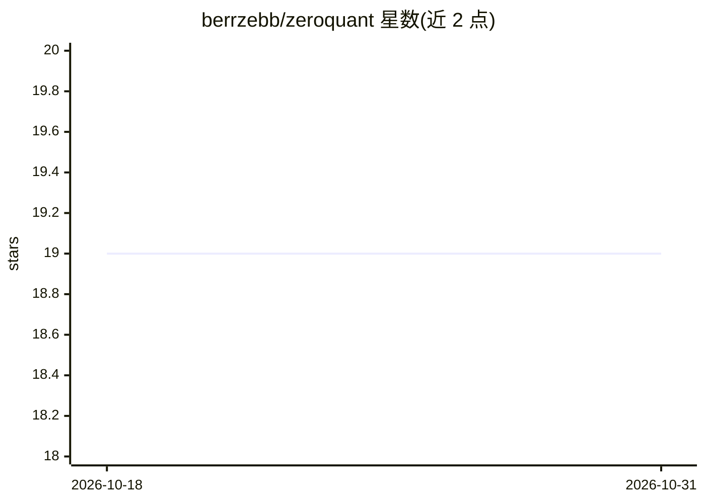

# berrzebb/zeroquant

⭐ 19 · Rust · MIT · 推送 2026-02-10 · [GitHub](https://github.com/berrzebb/zeroquant) · [官网](https://github.com/berrzebb/zeroquant) · 个人维护

**Rust 多市场自动交易系统：含 16 种策略与 ML 模式识别**

Rust 编写的加密货币与韩/美股自动交易系统，支持 Binance、Upbit、Bithumb、KIS 等交易所的 24/7 实盘、模拟与回测交易。内置 16 种集成策略（DCA、网格、动量、资产配置等）、59 个 ML 模式识别（35 个蜡烛形态 + 24 个图表形态，ONNX 推理）及 XGBoost/LightGBM 模型训练。数据存于 TimescaleDB，提供 SolidJS 风格的 Web 仪表盘、六类风险管理选项与多渠道告警。仅限学习研究用途，不构成投资建议。

## 筛选速览

| 维度 | 判定 | 备注 |
|---|---|---|
| AI 角色 | `ai-enhanced` | 去掉 AI 部分产品仍成立 |
| 许可风险 | `permissive` | MIT |
| 部署形态 | `self-host` | docker 或自建部署 |
| 模型依赖 | — | README 未给出锁定关系 |
| 硬件要求 | — | 无带数字的原话,不猜 |
| 安装摩擦 | `low` | 无编译、无系统依赖或容器化 |
| 成熟度 | — | 结构信号不足 |

## 能力要点

- 16 种集成策略，SignalProcessor trait 抽象实盘/模拟/回测三种执行模式
- 59 个 ML 模式识别（蜡烛 35 + 图表 24，ONNX 推理）与 XGBoost/LightGBM 训练
- TimescaleDB 时序存储与 WebSocket 实时行情（Singleton 流管理）
- 6 种风险选项（止损/止盈/追踪止损/利润锁定等）与 6 种预设

## 适用场景

- 在加密货币与韩美股票市场运行自动化策略并实时监控
- 不投实盘先用模拟账户验证策略表现
- 通过实现 Strategy trait 插件式开发自定义交易策略
- 下载历史数据做回测并生成净值曲线与回撤图表

## 场景标签

`金融量化` · 领域:学习与行业

## 证据(README 行号)

> L15:  Rust 기반 고성능 다중 시장 자동화 트레이딩 시스템
> L29: 검증된 **16가지 통합 전략**과 **59개 ML 패턴 인식** (캔들스틱 35개 + 차트 패턴 24개)을 통해 **그리드 트레이딩**, **자산배분**, **모멘텀** 등 다양한 투자 방법론을 지원합니다
> L64: - **ML 패턴 인식**: 캔들스틱 35개 + 차트 패턴 24개 (ONNX 추론)

## 星数曲线

2026-10-18 19 → 2026-10-31 19（+0）

---
*卡片 v1 · prompt 1.4 · 生成 2026-10-28 · 置信度 mid · 依据 README sha `5a8e9b137c77` · [字段定义](../../DATASET.md)*
