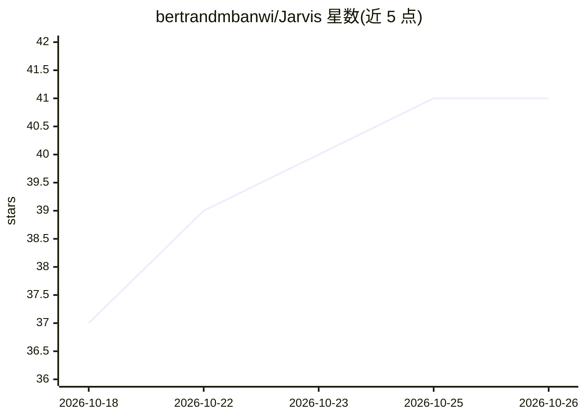

# bertrandmbanwi/Jarvis

⭐ 41 · Python · MIT · 推送 2026-10-03 · [GitHub](https://github.com/bertrandmbanwi/Jarvis) · 个人维护

**macOS 语音 AI 助手：对话控制电脑、浏览器与日常任务**

运行在 Mac 上的开源个人 AI 助手：支持唤醒词、本地语音识别（Moonshine/faster-whisper）与本地 TTS（Kokoro），可通过对话操作 106 个工具（应用、文件、Chrome、邮件、日历、shell、网页）。模型可选 OpenAI、Claude 或完全离线（Ollama/MLX/Apple 端侧模型）。包含 Playwright 浏览器自动化、Chrome 扩展、多 agent 任务分解、SQLite 语义记忆、MCP 双向接入与 Agent Skills。高风险操作需人工批准；完整功能需 macOS 12+（推荐 Apple Silicon）。

## 筛选速览

| 维度 | 判定 | 备注 |
|---|---|---|
| AI 角色 | `ai-native` | 本体是模型或模型工具 |
| 许可风险 | `permissive` | MIT |
| 部署形态 | `None` |  |
| 模型依赖 | local-ok | 支持本地模型 |
| 硬件要求 | — | 无带数字的原话,不猜 |
| 安装摩擦 | `medium` | 含编译或系统依赖之一 |
| 成熟度 | — | 结构信号不足 |

## 能力要点

- 106 个工具覆盖 macOS 控制、浏览器、邮件、日历与 shell
- OFFLINE_MODE=true 可完全离线运行（Ollama/MLX/Apple 端侧模型）
- 本地语音链路：OpenWakeWord 唤醒 + Moonshine STT + Kokoro TTS
- MCP 客户端/服务端双向接入，兼容 Claude/Codex 的 SKILL.md 技能格式

## 适用场景

- 用语音让助手查日历、读屏幕、填表单或写代码
- 完全离线在本地模型上运行个人 AI 助手
- 通过 Telegram/iMessage 远程下达指令并审批高风险操作
- 每天定时接收晨报与会议准备摘要

## 场景标签

`语音 Agent` `AI 助手` `浏览器自动化` · 领域:效率与自动化

## 证据(README 行号)

> L17: Say "Hey JARVIS" and it answers in a British voice. You can ask it to check your calendar, read the screen, fill a 
> L37: JARVIS lives on your Mac. Talk to it, type in the chat, or let it operate your computer. It can see your screen, ma

## 星数曲线

2026-10-18 37 → 2026-10-26 41（+4）

---
*卡片 v1 · prompt 1.4 · 生成 2026-10-25 · 置信度 high · 依据 README sha `e161c1dda08f` · [字段定义](../../DATASET.md)*
