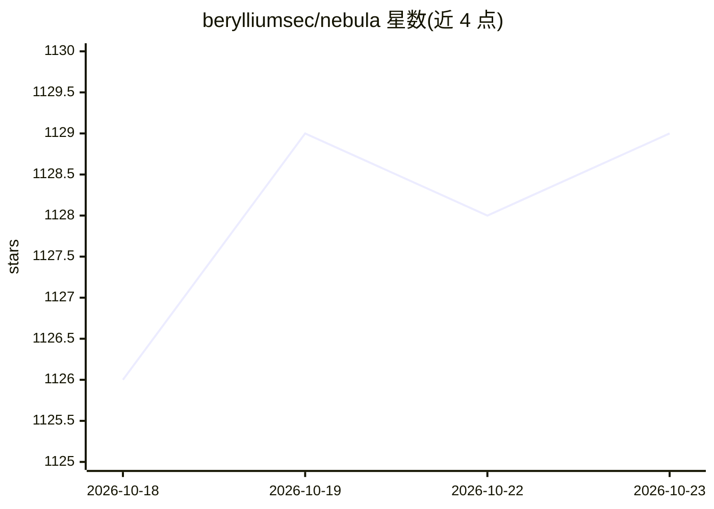

# berylliumsec/nebula

⭐ 1,129 · Python · BSD-2-Clause · 推送 2026-10-22 · [GitHub](https://github.com/berylliumsec/nebula) · [官网](https://www.berylliumsec.com) · 组织维护

**面向操作员的网络安全测试工作台，集成 AI 助手与 Kali 工具**

桌面端渗透测试 harness，把资产、浏览器会话、Kali 终端、笔记、发现与报告组织在同一 Project 中；内置浏览器流量拦截与 Repeater/Intruder 复测。可添加 SKILL.md 技能供助手调用，支持 Codex/Grok 作为 harness，或接入 Claude、OpenRouter、Ollama、vLLM。Butler 助手支持对话与 GPT-Live 语音（需 OpenAI API key，产生费用），并保留 SQLite 记忆与 Chroma 索引。通过 Docker/Podman 运行容器命令，可选 OpenVPN 出口；自动化动作受操作员的范围、审批与预算控制。Linux x86_64 提供签名 APT 仓库、DEB 与 AppImage 预览版。

## 筛选速览

| 维度 | 判定 | 备注 |
|---|---|---|
| AI 角色 | `ai-ecosystem` | LLM/agent 周边工具 |
| 许可风险 | `permissive` | BSD-2-Clause |
| 部署形态 | `None` |  |
| 模型依赖 | local-ok | 支持本地模型 |
| 硬件要求 | — | 无带数字的原话,不猜 |
| 安装摩擦 | `low` | 无编译、无系统依赖或容器化 |
| 成熟度 | `idea` | |

## 能力要点

- 单一 Project 聚合资产、浏览器会话、Kali 容器、发现与报告
- BYO 技能：SKILL.md 加入 Project 并在聊天中选用
- 支持 Codex/Grok harness，可接 Claude/OpenRouter/Ollama/vLLM
- 证据链：哈希存档、执行溯源、关联发现并导出报告
- Butler 助手含 GPT-Live 语音（需 OpenAI API key）与跨项目持久记忆

## 适用场景

- 在授权范围内组织一次完整渗透测试项目，管理工具与会话
- 让 AI 助手在范围、审批与预算约束下执行自动化测试动作
- 通过对话或语音委托与监督子代理的工作
- 保存哈希证据与执行溯源，导出合规报告

## 场景标签

`网络安全` `AI 助手` `语音 Agent` · 领域:对话与助手

## 证据(README 行号)

> L46: Use Codex or Grok as harnesses, or connect Claude, OpenRouter, Ollama, or vLLM. Docker or Podman powers Kali and co
> L17: - **Bring your own skills.** Add `SKILL.md` skills to a Project and select them in chat for assistant work.

## 星数曲线

2026-10-18 1,126 → 2026-10-23 1,129（+3）

---
*卡片 v1 · prompt 1.4 · 生成 2026-10-21 · 置信度 high · 依据 README sha `7a5485a59867` · [字段定义](../../DATASET.md)*
