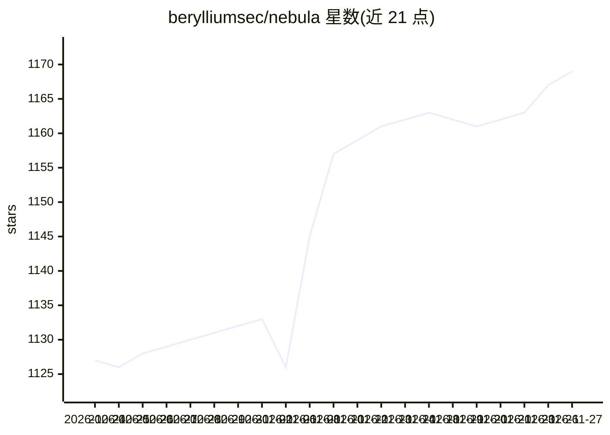

# berylliumsec/nebula

⭐ 1,169 · Python · BSD-2-Clause · 推送 2026-11-26 · [GitHub](https://github.com/berylliumsec/nebula) · [官网](https://www.berylliumsec.com) · 个人维护

**面向渗透测试人员的 AI 网络安全工作台**

围绕操作者构建的网络安全 harness：将资产、浏览器会话、Kali 终端、代码、笔记、发现与报告组织在单个 Project 中，提供安全浏览器与请求拦截/重放、容器化 Kali 工具执行（Docker/Podman）、可选 OpenVPN 出口，以及操作者控制的自动化（scope、审批、预算）。Butler 助手支持文本与 GPT-Live 语音（需 OpenAI API key，走 WebRTC），可将任务委派给主 agent 与子 agent，支持 SKILL.md 技能扩展与持久记忆（SQLite + Chroma 索引）。Linux x86_64 预览版提供 APT/DEB/AppImage，也可从源码构建。

## 筛选速览

| 维度 | 判定 | 备注 |
|---|---|---|
| AI 角色 | `ai-ecosystem` | LLM/agent 周边工具 |
| 许可风险 | `permissive` | BSD-2-Clause |
| 部署形态 | `None` |  |
| 模型依赖 | local-ok | 支持本地模型 |
| 硬件要求 | — | 无带数字的原话,不猜 |
| 安装摩擦 | `low` | 无编译、无系统依赖或容器化 |
| 成熟度 | `idea` | |

## 能力要点

- Butler 助手支持语音（GPT-Live/WebRTC）并可委派任务给 agent 层级
- 可接入 Codex、Grok、Claude 作为 harness，Claude/OpenRouter/Ollama/vLLM 作为 provider
- 安全浏览器拦截/重放与容器化 Kali 工具执行
- 哈希证据保存、执行溯源与报告导出

## 适用场景

- 在授权范围内集中管理渗透测试项目的资产与会话
- 用 AI 助手启动并推进安全评估任务
- 通过容器运行 Kali 工具并路由 VPN 出口流量
- 保留执行证据并导出 engagement 报告

## 场景标签

`网络安全` · 领域:学习与行业

## 证据(README 行号)

> L3:  Cybersecurity harness built around the operator
> L46: Use Codex, Grok or Claude as harnesses, or connect Claude, OpenRouter, Ollama, or vLLM as providers. Docker or Podm

## 星数曲线

2026-10-24 1,127 → 2026-11-27 1,169（+42）

---
*卡片 v1 · prompt 1.4 · 生成 2026-11-24 · 置信度 high · 依据 README sha `c783b8358f37` · [字段定义](../../DATASET.md)*
