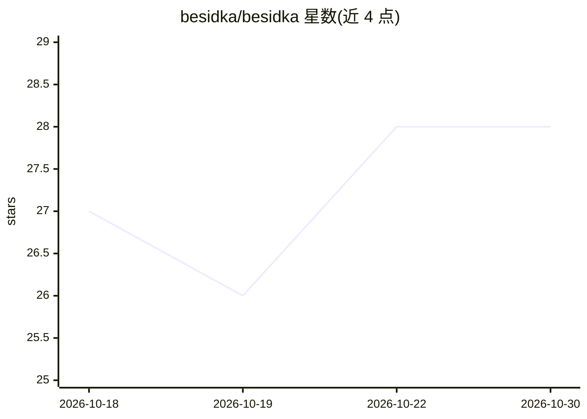

# besidka/besidka

⭐ 28 · TypeScript · MIT · 推送 2026-10-29 · [GitHub](https://github.com/besidka/besidka) · [官网](https://besidka.com) · 个人维护

**自带 API Key 的开源 AI 聊天应用，按用量付费**

面向不想再订阅 AI 服务的日常用户的 BYOK（bring your own key）聊天应用：用户在开发者控制台创建 API Key 后接入多家 LLM 提供商（Anthropic、Google、OpenAI、xAI、DeepSeek、Moonshot、Qwen），并可经 Vercel/Cloudflare/OpenRouter 网关路由。功能含多模型切换、网页搜索、推理模式、AI 生图、深度研究、对话分支与分享、项目管理、可恢复流。基于 Nuxt + Cloudflare Workers 技术栈，提供托管站点 besidka.com，也可自托管，本地运行需 PNPM 并执行一系列 wrangler/D1 迁移步骤；设计目标环境为 Cloudflare Workers。

## 筛选速览

| 维度 | 判定 | 备注 |
|---|---|---|
| AI 角色 | `ai-native` | 本体是模型或模型工具 |
| 许可风险 | `permissive` | MIT |
| 部署形态 | `library` | 以包/库形式分发 |
| 模型依赖 | locked-api |  |
| 硬件要求 | — | 无带数字的原话,不猜 |
| 安装摩擦 | `low` | 无编译、无系统依赖或容器化 |
| 成熟度 | — | 结构信号不足 |

## 能力要点

- BYOK 接入 Anthropic/Google/OpenAI/xAI/DeepSeek/Moonshot/Qwen，可经 Vercel/Cloudflare/OpenRouter 网关路由
- 显示每条消息的价格，按用量向提供商付费、无订阅无加价
- 深度研究、AI 生图、推理模式、网页搜索（Brave/Exa/原生）
- 对话分支、公开链接分享、项目共享指令与记忆、可恢复流

## 适用场景

- 用一个界面切换各家 LLM 模型聊天，只付实际用量
- 不想要 AI 订阅、愿意自己管理 API Key 的日常用户
- 自托管一个私有的多模型聊天与深度研究工具

## 场景标签

`聊天机器人` `AI 助手` · 领域:对话与助手

## 证据(README 行号)

> L3: Besidka is an open-source BYOK (bring your own key) AI chat app. Pay the AI provider only for what you use, see the 
> L9: Besidka suits people who use AI every day for search, translation, PDFs, images or code, do not want another subscri
> L43: - **BYOK (Bring Your Own API Key):** Use your API keys from any supported LLM provider (Anthropic, Google, OpenAI, 

## 星数曲线

2026-10-18 27 → 2026-10-30 28（+1）

---
*卡片 v1 · prompt 1.4 · 生成 2026-10-26 · 置信度 mid · 依据 README sha `3c75bfd9fe51` · [字段定义](../../DATASET.md)*
