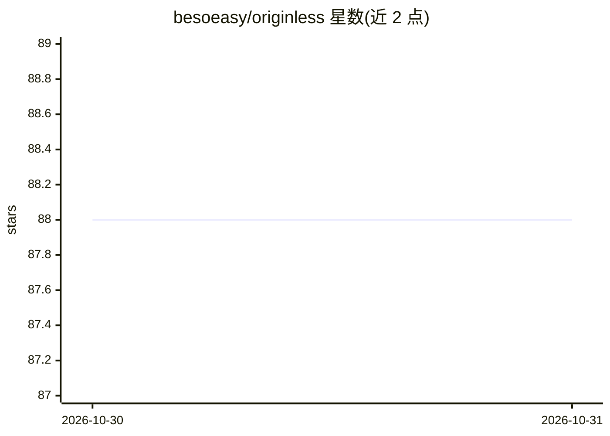

# besoeasy/originless

⭐ 88 · Go · MIT · 推送 2026-10-29 · [GitHub](https://github.com/besoeasy/originless) · [官网](https://originless.space/) · 个人维护

**自托管内容寻址文件托管服务：CID 即永久地址**

单容器自托管文件托管服务，内置 Kubo（IPFS 节点）、HTTP API 与仪表盘。文件地址为内容哈希 CID，与域名、服务器、账号无关：同一字节重新上传得到同一 CID，可用任意 IPFS 客户端获取。容器仓库为临时存储，未 pin 内容会被垃圾回收，需保留本地原件并按 manifest 重传。提供 /up、/upf、/ipfs、/healthz 等路由，支持 Range/ETag、文件夹上传、1GB 单次上传上限；默认仅本地服务，无账号与鉴权。

## 筛选速览

| 维度 | 判定 | 备注 |
|---|---|---|
| AI 角色 | `ai-ecosystem` | LLM/agent 周边工具 |
| 许可风险 | `permissive` | MIT |
| 部署形态 | `self-host` | docker 或自建部署 |
| 模型依赖 | — | README 未给出锁定关系 |
| 硬件要求 | — | 无带数字的原话,不猜 |
| 安装摩擦 | `low` | 无编译、无系统依赖或容器化 |
| 成熟度 | — | 结构信号不足 |

## 能力要点

- CID 内容寻址：地址由内容哈希派生，重传同字节得到同地址
- 单容器集成 Kubo、HTTP API 与 dashboard，无需域名/DNS/反向代理
- 支持文件夹上传、Range/ETag 流式请求、内容去重
- 默认本地网关（不代取任意 IPFS 内容），提供 keepalive 脚本按 manifest 重传

## 适用场景

- 在家用服务器托管图片/附件，用 CID 在论坛、Reddit、Nostr 帖子中引用
- 为 AI agent 与 LLM 工作流提供可哈希校验的稳定文件 URL
- 发布按哈希寻址的软件产物供用户校验下载
- 社区多人持有并重传同一批文件形成共享档案地址

## 场景标签

 · 领域:自托管/文件托管基础设施

## 证据(README 行号)

> L105: |**AI agents and LLM workflows**|Give agents stable URLs for context files, datasets, screenshots, and outputs. Ha

## 星数曲线

2026-10-30 88 → 2026-10-31 88（+0）

---
*卡片 v1 · prompt 1.4 · 生成 2026-10-30 · 置信度 mid · 依据 README sha `f4e23681bf72` · [字段定义](../../DATASET.md)*
