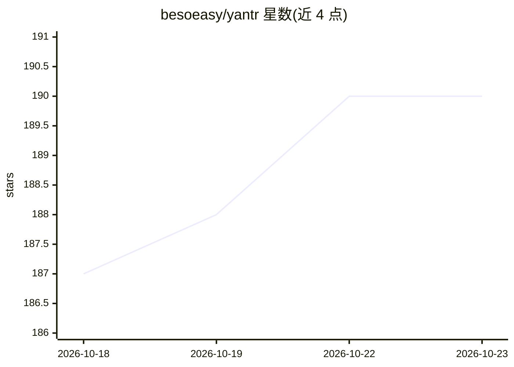

# besoeasy/yantr

⭐ 190 · Vue · NOASSERTION · 推送 2026-10-21 · [GitHub](https://github.com/besoeasy/yantr) · [官网](https://yantr.org) · 个人维护

**基于 rootless Podman 的自托管 homelab 应用商店**

以单个 rootless 容器形式运行在已有 Linux 机器上的自托管应用商店：通过精选目录一键部署 Podman Compose 栈（含 AI、媒体、下载、安全等类别），目录含 Open WebUI、Perplexica 等应用。面向不想为 Umbrel 类平台专机的 homelab 用户。关键机制：基于 rootless Podman 的无守护进程架构、systemd Quadlet 集成、Docker socket 自动转换（兼容 Portainer 等应用）、REST API 脚本化操作。限制：仅支持 Linux + Podman + systemd（不支持 Alpine），需以普通用户运行，许可证为 PolyForm Noncommercial（非商用）。

## 筛选速览

| 维度 | 判定 | 备注 |
|---|---|---|
| AI 角色 | `ai-enhanced` | 去掉 AI 部分产品仍成立 |
| 许可风险 | `none` | NOASSERTION |
| 部署形态 | `self-host` | docker 或自建部署 |
| 模型依赖 | — | README 未给出锁定关系 |
| 硬件要求 | — | 无带数字的原话,不猜 |
| 安装摩擦 | `low` | 无编译、无系统依赖或容器化 |
| 成熟度 | — | 结构信号不足 |

## 能力要点

- 精选应用目录一键部署为 Podman Compose 栈
- 自动将 /var/run/docker.sock 请求路由到 rootless Podman socket
- systemd Quadlet 集成，开机自启并以 systemctl --user 管理
- 全部操作暴露为 REST API JSON 端点

## 适用场景

- 在笔记本/树莓派/旧 PC 上不重装系统地自助部署自托管应用
- 以 rootless 隔离方式运行 Nextcloud、Vaultwarden、AI 应用等服务
- 通过浏览器管理各部署的环境变量与数据卷

## 场景标签

 · 领域:自托管/家庭服务器运维

## 证据(README 行号)

> L5: **A self-hosted app store that runs alongside your OS — not instead of it.**
> L23: **Yantr is an app, not an OS.** It runs as a single rootless container on the machine you already have — laptop, Ra
> L130: |🤖 AI & Agents|Open WebUI, Perplexica, Agent Zero, Kokoro|

## 星数曲线

2026-10-18 187 → 2026-10-23 190（+3）

---
*卡片 v1 · prompt 1.4 · 生成 2026-10-22 · 置信度 mid · 依据 README sha `3ea47c244a92` · [字段定义](../../DATASET.md)*
