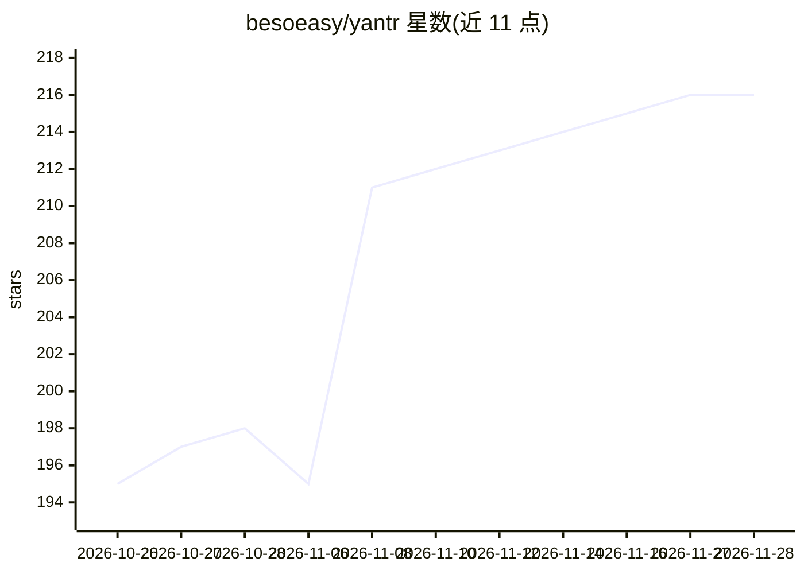

# besoeasy/yantr

⭐ 216 · Vue · NOASSERTION · 推送 2026-11-26 · [GitHub](https://github.com/besoeasy/yantr) · [官网](https://yantr.org) · 个人维护

**一条命令在自有 Linux 上以 rootless Podman 自托管应用目录中的应用**

以单个 rootless 容器形式运行的 Linux 自托管应用管理器，内置含 Jellyfin、Nextcloud、Ollama、Pi-hole、n8n 等 170+ 应用的目录。安装脚本自动配置 rootless Podman 与 systemd Quadlet，支持 Fedora/Debian/Ubuntu/Arch/openSUSE 的包管理器探测；应用栈以用户空间运行，日志走 journalctl，开机自启动，卸载同为一条命令。限制：需 systemd（Alpine 除外），采用 PolyForm Noncommercial 许可。

## 筛选速览

| 维度 | 判定 | 备注 |
|---|---|---|
| AI 角色 | `ai-enhanced` | 去掉 AI 部分产品仍成立 |
| 许可风险 | `none` | NOASSERTION |
| 部署形态 | `self-host` | docker 或自建部署 |
| 模型依赖 | — | README 未给出锁定关系 |
| 硬件要求 | — | 无带数字的原话,不猜 |
| 安装摩擦 | `low` | 无编译、无系统依赖或容器化 |
| 成熟度 | — | 结构信号不足 |

## 能力要点

- rootless/daemonless：以普通用户运行，安装器拒绝 sudo
- 170+ 应用的自托管目录，一条命令安装/更新/卸载
- 原生 systemd Quadlet 与 journalctl --user 集成
- GHCR 多架构镜像（amd64/arm64），cosign 签名

## 适用场景

- 在家庭服务器/旧 PC/树莓派上自托管媒体、网盘等应用
- 不想给 Docker root 权限的家用环境部署容器应用
- 以普通用户身份管理多个自托管服务并开机自启

## 场景标签

 · 领域:自托管/容器应用管理

## 证据(README 行号)

> L11: Jellyfin · Nextcloud · Ollama · Pi-hole · n8n · **+170 more**
> L35: **Yantr is an app, not an OS.** It runs as a single rootless container on the machine you already have — laptop, Ra

## 星数曲线

2026-10-26 195 → 2026-11-28 216（+21）

---
*卡片 v1 · prompt 1.4 · 生成 2026-11-25 · 置信度 low · 依据 README sha `ca727b8144c2` · [字段定义](../../DATASET.md)*
