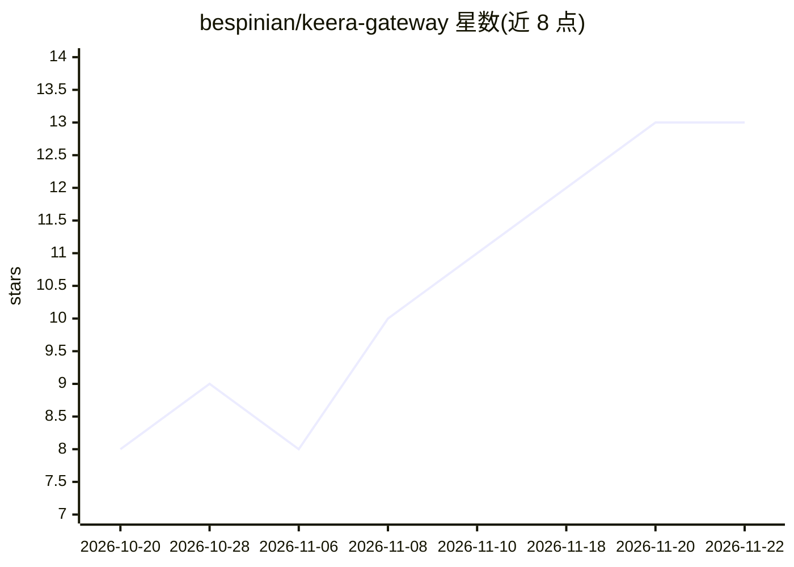

# bespinian/keera-gateway

⭐ 13 · Go · NOASSERTION · 推送 2026-11-17 · [GitHub](https://github.com/bespinian/keera-gateway) · [官网](https://keera.ch/en/gateway) · 组织维护

**给企业所有 AI 模型请求提供统一端点的 LLM 网关**

用 Go 编写的单二进制 LLM 网关，部署在自托管模型与授权托管模型之前，统一检查、记账并转发请求。支持 OpenAI、Anthropic Messages、OpenAI Responses 与 rerank API。机制包括按组织/项目/密钥挂载的护栏、预算与限速（租户继承只可收紧）、请求过滤器（含影子模式）、路由器（按任务分流模型、故障回退）、MCP 服务器管控、代理计费与 Web 控制面板。需配合 Postgres，经 podman compose 单主机部署。

## 筛选速览

| 维度 | 判定 | 备注 |
|---|---|---|
| AI 角色 | `ai-ecosystem` | LLM/agent 周边工具 |
| 许可风险 | `none` | NOASSERTION |
| 部署形态 | `None` |  |
| 模型依赖 | locked-api |  |
| 硬件要求 | — | 无带数字的原话,不猜 |
| 安装摩擦 | `low` | 无编译、无系统依赖或容器化 |
| 成熟度 | — | 结构信号不足 |

## 能力要点

- 提供 OpenAI、Anthropic Messages、OpenAI Responses 三套 API 端点，统一护栏与审计
- 路由器可按任务规模分流本地/托管模型，托管预算耗尽后回退本地模型
- 过滤器在转发前移除凭据/客户名等敏感信息，支持影子模式评估
- MCP 服务器与托管模型同样纳入护栏、预算与审计日志

## 适用场景

- 为企业内部所有模型的调用统一入口并记录审计日志
- 按项目与密钥设置预算、限速与可用模型白名单
- 在转发到托管模型前过滤请求中的敏感信息
- 从 Slack 等聊天入口以使用者身份启动受管控的 agent

## 场景标签

`模型网关` · 领域:Agent 开发

## 证据(README 行号)

> L1: # Keera Gateway - one endpoint for every AI request
> L29: Every tool that calls a model uses the same address. The gateway checks each
> L43: The gateway speaks three APIs, all with the same guardrails, accounting and

## 星数曲线

2026-10-20 8 → 2026-11-22 13（+5）

---
*卡片 v1 · prompt 1.4 · 生成 2026-11-18 · 置信度 high · 依据 README sha `e1c53a437c97` · [字段定义](../../DATASET.md)*
