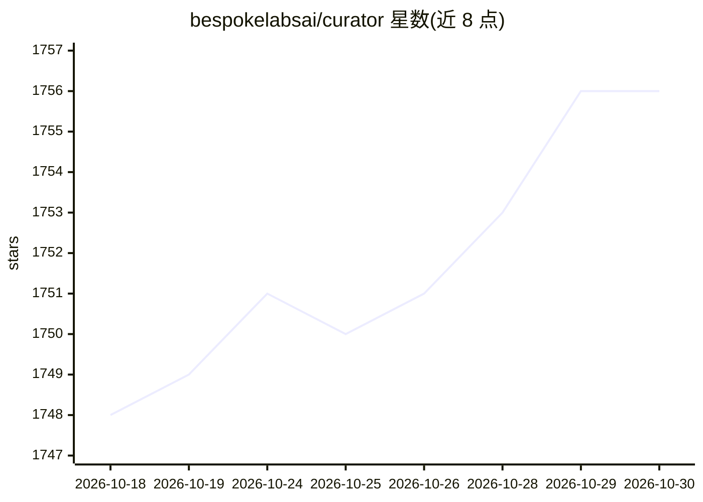

# bespokelabsai/curator

⭐ 1,756 · Python · Apache-2.0 · 推送 2026-10-28 · [GitHub](https://github.com/bespokelabsai/curator) · [官网](https://docs.bespokelabs.ai/bespoke-curator) · 组织维护 · 中文 README

**面向后训练的合成数据生成与批量推理 Python 库**

Bespoke Labs 维护的 Python 库，用于构建合成数据流水线与结构化数据提取：通过继承 curator.LLM 定义 prompt/parse 方法批量调用 LLM，输出 HuggingFace Dataset；内置异步、缓存、重试与故障恢复优化，支持结构化输出、batch 模式（OpenAI/Anthropic 等）、多后端（OpenAI 兼容、LiteLLM、Ollama、vLLM、kluster.ai），并集成 Tinker 与 Fireworks AI 做托管 LoRA 微调。以 pip 包分发，带查看器监控数据生成过程。限制：需外部 LLM API key；Ollama 后端需本地服务运行。

## 筛选速览

| 维度 | 判定 | 备注 |
|---|---|---|
| AI 角色 | `ai-ecosystem` | LLM/agent 周边工具 |
| 许可风险 | `permissive` | Apache-2.0 |
| 部署形态 | `library` | 以包/库形式分发 |
| 模型依赖 | local-ok | 支持本地模型 |
| 硬件要求 | — | 无带数字的原话,不猜 |
| 安装摩擦 | `low` | 无编译、无系统依赖或容器化 |
| 成熟度 | — | 结构信号不足 |

## 能力要点

- 批量推理与合成数据流水线库，输出 HuggingFace Dataset
- 内置异步、缓存、重试与故障恢复优化
- 支持 OpenAI/LiteLLM/Ollama/vLLM/kluster.ai 等多种后端
- Tinker 与 Fireworks AI 托管 LoRA 微调集成

## 适用场景

- 为模型微调/蒸馏生成训练数据集
- 批量调用 LLM 做结构化数据提取
- 生成后接 LoRA 微调的端到端流水线

## 场景标签

`微调` · 领域:训练与推理

## 证据(README 行号)

> L8:  Bulk Inference and Scalable Data Curation for Post-Training
> L34: Bespoke Curator makes it easy to create synthetic data pipelines. Whether you are training a model or extracting st
> L36: * Rich Python based library for generating and curating synthetic data.

## 星数曲线

2026-10-18 1,748 → 2026-10-30 1,756（+8）

---
*卡片 v1 · prompt 1.4 · 生成 2026-10-21 · 置信度 high · 依据 README sha `9c99320b7b05` · [字段定义](../../DATASET.md)*
