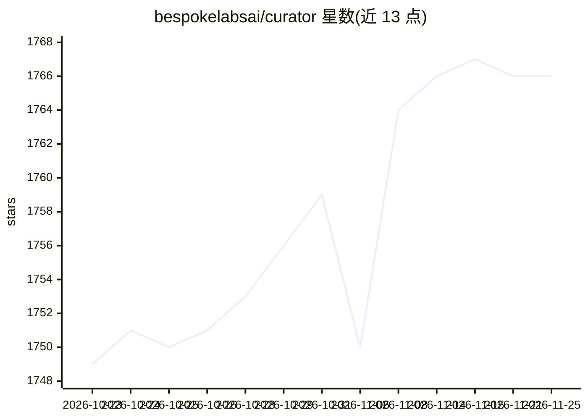

# bespokelabsai/curator

⭐ 1,766 · Python · Apache-2.0 · 推送 2026-11-02 · [GitHub](https://github.com/bespokelabsai/curator) · [官网](https://docs.bespokelabs.ai/bespoke-curator) · 组织维护 · 中文 README

**面向后训练数据准备的开发者库：批量推理与合成数据生产**

Bespoke Curator 是一个 Python 库，用于构建合成数据管道与结构化数据提取：开发者定义 prompt 与 parse 函数，库以异步批量推理生成数据并输出 HuggingFace Dataset。内置缓存、重试与故障恢复，支持 OpenAI/Anthropic 批处理 API 降低成本；通过 LiteLLM、vLLM、Ollama 等后端接入多种模型，并提供 Tinker、Fireworks AI 的 LoRA 微调训练器接口。安装为 pip 包，需自行设置所调模型的环境变量 API key。

## 筛选速览

| 维度 | 判定 | 备注 |
|---|---|---|
| AI 角色 | `ai-ecosystem` | LLM/agent 周边工具 |
| 许可风险 | `permissive` | Apache-2.0 |
| 部署形态 | `library` | 以包/库形式分发 |
| 模型依赖 | local-ok | 支持本地模型 |
| 硬件要求 | — | 无带数字的原话,不猜 |
| 安装摩擦 | `low` | 无编译、无系统依赖或容器化 |
| 成熟度 | — | 结构信号不足 |

## 能力要点

- curator.LLM 块式接口做批量推理与结构化输出，可直接转 HuggingFace Dataset
- 支持 OpenAI/Anthropic 等批量 API（batch 模式）以降低 token 成本
- 通过 LiteLLM、vLLM、Ollama、DeepSeek、kluster.ai 等后端接入多种模型
- TinkerTrainer/FireworksTrainer 统一接口，从数据到 LoRA 微调，支持 checkpoint 恢复

## 适用场景

- 为微调/蒸馏生成推理类合成数据集
- 从文本中批量提取结构化字段（如情感分析、特征抽取）
- 大预算下用 batch API 降低大规模数据生成成本
- 用本地 Ollama 或 vLLM 模型做离线数据生产

## 场景标签

`微调` · 领域:训练与推理

## 证据(README 行号)

> L34: Bespoke Curator makes it easy to create synthetic data pipelines. Whether you are training a model or extracting st
> L39: * Support for a wide range of inference options via LiteLLM, vLLM, and popular batch APIs.
> L238: Curator integrates with the Tinker SDK so you can go from curated data to a LoRA fine-tuned model in a few lines o

## 星数曲线

2026-10-23 1,749 → 2026-11-25 1,766（+17）

---
*卡片 v1 · prompt 1.4 · 生成 2026-11-23 · 置信度 high · 依据 README sha `39b3c674d014` · [字段定义](../../DATASET.md)*
