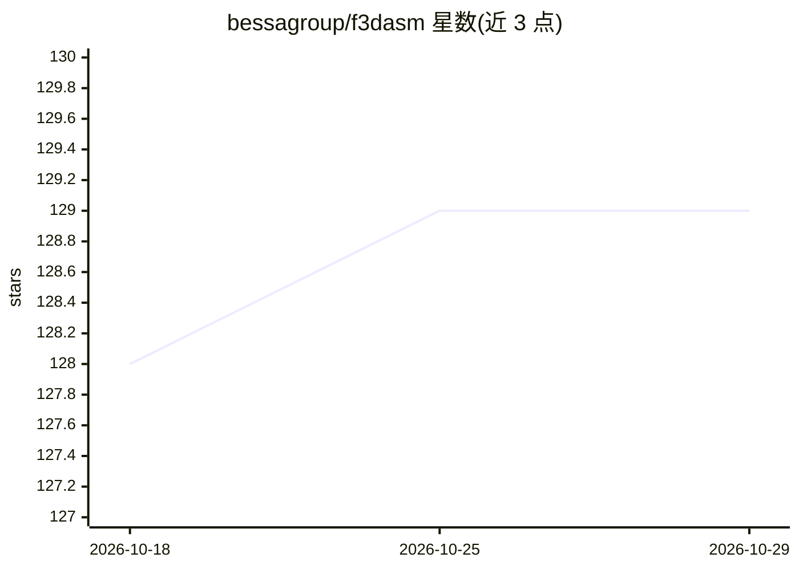

# bessagroup/f3dasm

⭐ 129 · Python · BSD-3-Clause · 推送 2026-09-01 · [GitHub](https://github.com/bessagroup/f3dasm) · [官网](https://f3dasm.readthedocs.io/) · 组织维护

**结构与材料数据驱动设计和分析的 Python 框架**

面向材料与结构领域研究者和工程师的数据驱动设计分析 Python 框架：提供模块化接口供用户接入自己的模型与算法，自动管理数据 I/O，支持实验并行化（兼容本地与高性能集群），内置基准函数、优化算法与采样策略，并集成 Hydra 配置管理器用于组织实验。附带基准研究（如 'Fragile Becomes Supercompressible'）。由代尔夫特理工大学博士生开发，发表于 JOSS，团队规模小、支持能力有限。

## 筛选速览

| 维度 | 判定 | 备注 |
|---|---|---|
| AI 角色 | `ai-ecosystem` | LLM/agent 周边工具 |
| 许可风险 | `permissive` | BSD-3-Clause |
| 部署形态 | `library` | 以包/库形式分发 |
| 模型依赖 | — | README 未给出锁定关系 |
| 硬件要求 | — | 无带数字的原话,不猜 |
| 安装摩擦 | `low` | 无编译、无系统依赖或容器化 |
| 成熟度 | — | 结构信号不足 |

## 能力要点

- 模块化接口，可接入用户自有模型与算法
- 自动管理数据 I/O 与实验并行化（本地/HPC 集群）
- 内置基准函数、优化算法与采样策略
- 集成 Hydra 配置管理器

## 适用场景

- 材料与结构的数据驱动设计研究
- 对优化算法在基准函数上做对比实验
- 在本地或 HPC 集群上并行运行实验

## 场景标签

 · 领域:材料科学/计算力学

## 证据(README 行号)

> L21: `f3dasm` introduces a general and user-friendly data-driven Python package for researchers and practitioners workin
> L30:  - The framework manages parallelization of experiments, and is compatible with both local and high-performance clu

## 星数曲线

2026-10-18 128 → 2026-10-29 129（+1）

---
*卡片 v1 · prompt 1.4 · 生成 2026-10-22 · 置信度 high · 依据 README sha `82ffabb0beaa` · [字段定义](../../DATASET.md)*
