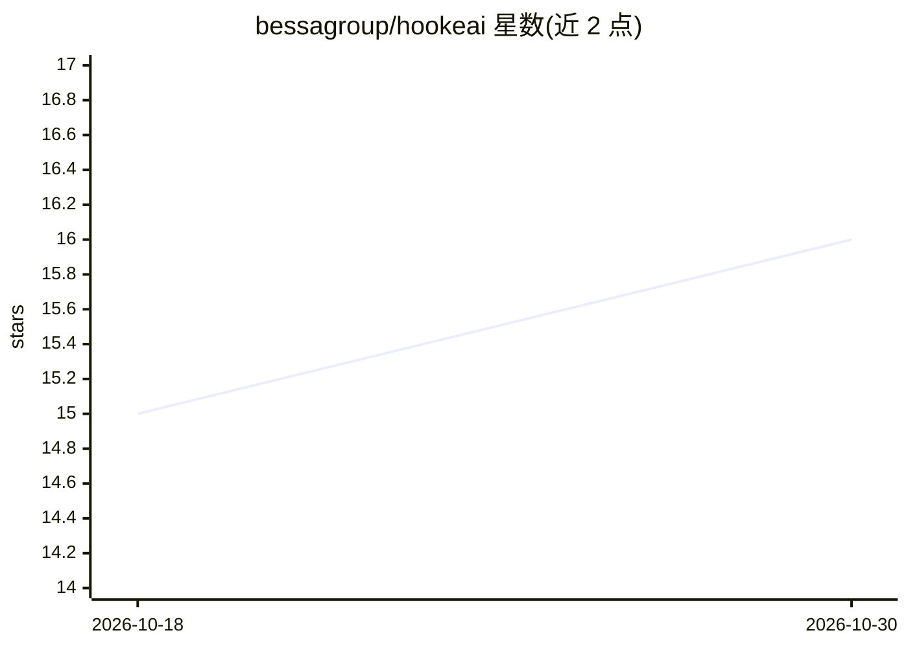

# bessagroup/hookeai

⭐ 16 · Python · MIT · 推送 2025-12-08 · [GitHub](https://github.com/bessagroup/hookeai) · 个人维护

**科研用的材料模型发现框架：从数据反演本构模型**

基于 PyTorch 的开源 Python 包，实现自动可微模型更新（ADiMU）框架，用于从应变-应力、位移-载荷等数据中发现含历史依赖性的材料本构模型，支持物理驱动、数据驱动（神经网络）与混合三类模型。内置数据生成方法、可定制的材料模型架构以及数据分析与可视化工具，面向固体力学教学、科研与工业仿真场景。附带 JMPS 期刊论文并要求科研引用；具体安装与使用内容在文档站中，README 未直接给出命令。

## 筛选速览

| 维度 | 判定 | 备注 |
|---|---|---|
| AI 角色 | `ai-native` | 本体是模型或模型工具 |
| 许可风险 | `permissive` | MIT |
| 部署形态 | `None` |  |
| 模型依赖 | — | README 未给出锁定关系 |
| 硬件要求 | — | 无带数字的原话,不猜 |
| 安装摩擦 | `low` | 无编译、无系统依赖或容器化 |
| 成熟度 | — | 结构信号不足 |

## 能力要点

- ADiMU 框架：自动微分驱动的历史依赖材料模型反演
- 支持物理驱动/神经网络/混合三类材料模型
- 内置数据生成、模型架构定制与数据分析可视化工具
- 基于 PyTorch，利用自动微分、优化与 GPU 向量化

## 适用场景

- 从实验或数值数据中反演材料本构模型
- 开发与测试新型材料模型架构并建立可复现基准
- 固体力学与机器学习交叉课程的教学实践

## 场景标签

`科研工具` `教程课程` · 领域:学习与行业

## 证据(README 行号)

> L11: **HookeAI** is an open-source Python package built on PyTorch to perform material model updating at the intersectio
> L16: In an era where a multidisciplinary approach is increasingly essential for scientific and technological progress, *

## 星数曲线

2026-10-18 15 → 2026-10-30 16（+1）

---
*卡片 v1 · prompt 1.4 · 生成 2026-10-30 · 置信度 high · 依据 README sha `27df41c58885` · [字段定义](../../DATASET.md)*
