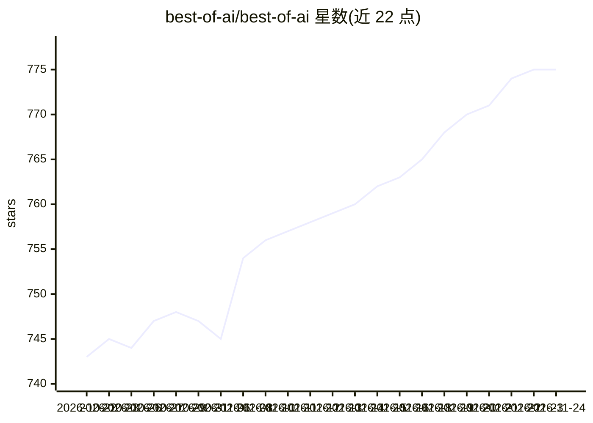

# best-of-ai/best-of-ai

⭐ 777 · HTML · 推送 2026-11-23 · [GitHub](https://github.com/best-of-ai/best-of-ai) · [官网](https://bestofai.io) · 组织维护

**面向AI工具使用者的社区策展工具目录（2174+工具，143类）**

由社区驱动的 AI 工具策展目录，收录并跟踪 2174+ 个工具，按 143 个类别（从代码助手到视频到医疗）组织，另设按职业划分的工具栈（设计师、开发者、营销等）。README 提供排行榜（Top 108）与分类条目列表，每条含评级标签与定价模式；完整交互式目录（搜索、过滤、详细评审）托管于 bestofai.io，并开放工具提交与贡献渠道。

## 筛选速览

| 维度 | 判定 | 备注 |
|---|---|---|
| AI 角色 | `ai-knowledge` | 知识聚合/清单类 |
| 许可风险 | `none` | — |
| 部署形态 | `None` |  |
| 模型依赖 | — | README 未给出锁定关系 |
| 硬件要求 | — | 无带数字的原话,不猜 |
| 安装摩擦 | `medium` | 含编译或系统依赖之一 |
| 成熟度 | — | 结构信号不足 |

## 能力要点

- 收录并跟踪 2174+ 个 AI 工具，覆盖 143 个类别
- 排行榜列出 Top 108 工具及评级标签与定价模式
- 按职业提供策展工具栈（设计/开发/营销等）
- 完整目录提供搜索、过滤与详细评审，开放工具提交

## 适用场景

- 按类别或职业查找合适的 AI 工具
- 查看某类工具（聊天机器人/自动化/客服等）的收录清单
- 向目录提交自己的 AI 工具

## 场景标签

`精选清单` · 领域:学习与行业

## 证据(README 行号)

> L16: **Best of AI** is a curated, community-driven directory of the best AI tools across 143 categories. We track 2174+ 
> L22: - **Broad coverage** — 143 categories from Code Assistants to Video to Healthcare

## 星数曲线

2026-10-22 743 → 2026-11-24 775（+32）

---
*卡片 v1 · prompt 1.4 · 生成 2026-11-24 · 置信度 high · 依据 README sha `8c6611fe0797` · [字段定义](../../DATASET.md)*
