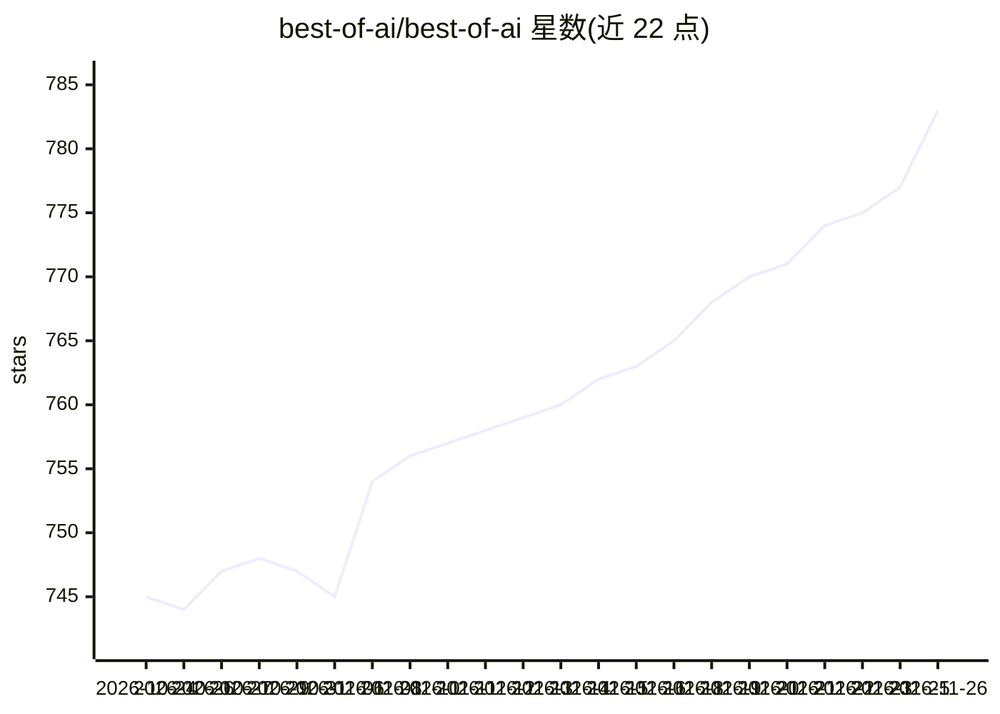

# best-of-ai/best-of-ai

⭐ 783 · HTML · 推送 2026-11-25 · [GitHub](https://github.com/best-of-ai/best-of-ai) · [官网](https://bestofai.io) · 组织维护

**AI 工具社区目录：143 类收录 2209+ 工具供选型查找**

一个社区维护的 AI 工具目录，覆盖 143 个类别、跟踪 2209+ 个工具，按质量、创新与实用性筛选并排名，收录条目附评级标签与免费/付费标识。README 展示前 108 名排行榜及 Productivity、Chatbots、Academia、Audio 等类别的条目摘录；完整交互式目录（搜索、过滤、详细评测）托管在 bestofai.io。社区可提交工具。以清单形式提供，不含安装或运行步骤。

## 筛选速览

| 维度 | 判定 | 备注 |
|---|---|---|
| AI 角色 | `ai-knowledge` | 知识聚合/清单类 |
| 许可风险 | `none` | — |
| 部署形态 | `None` |  |
| 模型依赖 | — | README 未给出锁定关系 |
| 硬件要求 | — | 无带数字的原话,不猜 |
| 安装摩擦 | `medium` | 含编译或系统依赖之一 |
| 成熟度 | — | 结构信号不足 |

## 能力要点

- 143 个类别、跟踪 2209+ 个 AI 工具
- 条目经人工筛选与排名并标注定价模式
- 按职业（设计师/开发者/营销）组织工具集
- 提供 bestofai.io 交互式目录与工具提交通道

## 适用场景

- 按类别查找特定用途的 AI 工具
- 为设计师/开发者等职业找配套工具栈
- 提交自己的 AI 工具进入目录

## 场景标签

`精选清单` · 领域:学习与行业

## 证据(README 行号)

> L16: **Best of AI** is a curated, community-driven directory of the best AI tools across 143 categories. We track 2209+ 
> L20: - **Quality over quantity** — every tool is reviewed and ranked, not just scraped from a list

## 星数曲线

2026-10-24 745 → 2026-11-26 783（+38）

---
*卡片 v1 · prompt 1.4 · 生成 2026-11-26 · 置信度 high · 依据 README sha `df44a7dcde61` · [字段定义](../../DATASET.md)*
