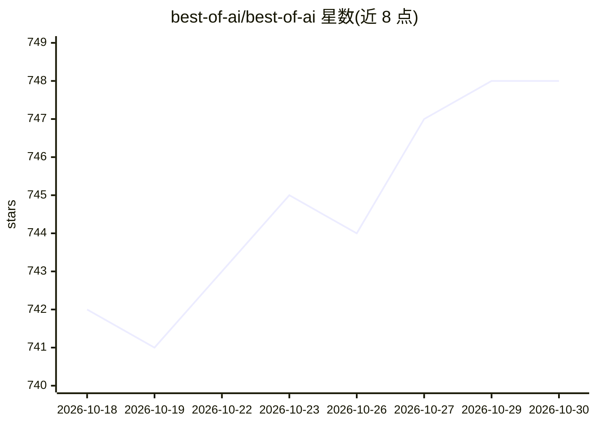

# best-of-ai/best-of-ai

⭐ 748 · HTML · 推送 2026-10-29 · [GitHub](https://github.com/best-of-ai/best-of-ai) · [官网](https://bestofai.io) · 组织维护

**AI 工具策展目录：143 类 1318+ 工具的排名与分类清单**

社区驱动的 AI 工具目录（bestofai.io 的 GitHub 呈现）：跟踪 1318+ 工具、覆盖 143 个类别（从代码助手、视频到医疗）。提供 100 个工具的排行榜（每条标注定价标签与 review 链接），以及按类别组织的条目列表，每类展示前若干工具并链接到网站的完整列表；另按职业提供工具栈浏览。README 中工具条目附简短描述，完整评审需访问网站。

## 筛选速览

| 维度 | 判定 | 备注 |
|---|---|---|
| AI 角色 | `ai-knowledge` | 知识聚合/清单类 |
| 许可风险 | `none` | — |
| 部署形态 | `None` |  |
| 模型依赖 | — | README 未给出锁定关系 |
| 硬件要求 | — | 无带数字的原话,不猜 |
| 安装摩擦 | `low` | 无编译、无系统依赖或容器化 |
| 成熟度 | — | 结构信号不足 |

## 能力要点

- 1318+ 工具、143 个类别的人工筛选目录
- 含 100 名以内的质量排行榜与定价标签
- 每类别展示部分条目并链接至网站完整列表
- 提供面向设计师、开发者、营销者等职业的工具栈

## 适用场景

- 按类别查找特定领域的 AI 工具（音频、学术、医疗等）
- 查看按质量排名的 AI 工具榜单
- 按职业浏览推荐的工具组合

## 场景标签

`精选清单` · 领域:学习与行业

## 证据(README 行号)

> L14: **Best of AI** is a curated, community-driven directory of the best AI tools across 143 categories. We track 1318+ 
> L20: - **Broad coverage** — 143 categories from Code Assistants to Video to Healthcare

## 星数曲线

2026-10-18 742 → 2026-10-30 748（+6）

---
*卡片 v1 · prompt 1.4 · 生成 2026-10-21 · 置信度 high · 依据 README sha `87f71866c714` · [字段定义](../../DATASET.md)*
