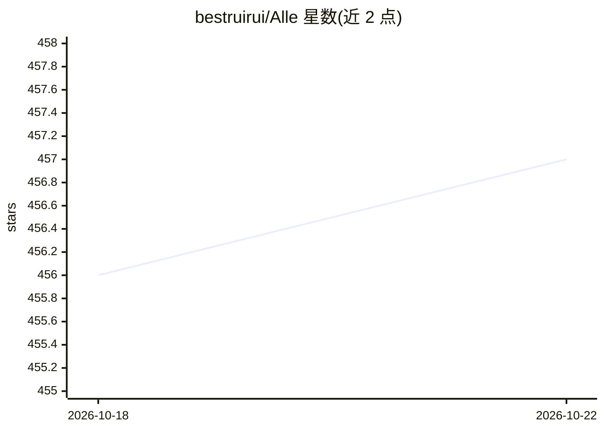

# bestruirui/Alle

⭐ 457 · TypeScript · 推送 2026-06-05 · [GitHub](https://github.com/bestruirui/Alle) · 个人维护 · 中文 README

**个人邮件聚合客户端：转发集中收信并 AI 提取验证码与链接**

面向个人用户的邮件聚合与管理平台：依托各邮箱服务商的自动转发功能，将多个邮箱（Gmail、Outlook、QQ 邮箱及自定义域名）的邮件集中到专属地址统一查看，无需输入邮箱密码。内置 AI 引擎分析邮件内容，自动提取验证码，并区分验证链接、服务通知链接与订阅退订链接。另基于 Cloudflare Workers 提供无限数量临时邮箱。采用 Next.js 开发，仅需一个域名即可部署到 Cloudflare Workers，无需额外服务器。

## 筛选速览

| 维度 | 判定 | 备注 |
|---|---|---|
| AI 角色 | `ai-enhanced` | 去掉 AI 部分产品仍成立 |
| 许可风险 | `none` | — |
| 部署形态 | `None` |  |
| 模型依赖 | — | README 未给出锁定关系 |
| 硬件要求 | — | 无带数字的原话,不猜 |
| 安装摩擦 | `low` | 无编译、无系统依赖或容器化 |
| 成熟度 | — | 结构信号不足 |

## 能力要点

- 通过邮箱转发规则聚合多账户邮件，无需邮箱密码
- AI 提取验证码并分类验证/服务/订阅三类链接
- 基于 Cloudflare Workers 生成无限数量临时邮箱
- 仅需一个域名即可部署到 Cloudflare Workers

## 适用场景

- 在一个界面统一查看多个邮箱的收件内容
- 快速获取并复制邮件中的验证码
- 注册网站时使用临时邮箱保护主邮箱隐私
- 快速找到并清理广告邮件的退订链接

## 场景标签

 · 领域:个人效率/邮件工具

## 证据(README 行号)

> L7: **Alle** 是一款专为个人用户打造的 **邮件聚合与管理平台**。
> L39: Alle 内置的 AI 引擎可对邮件内容进行分析，自动识别并提取关键信息。

## 星数曲线

2026-10-18 456 → 2026-10-22 457（+1）

---
*卡片 v1 · prompt 1.4 · 生成 2026-10-21 · 置信度 high · 依据 README sha `af9e27b9178b` · [字段定义](../../DATASET.md)*
