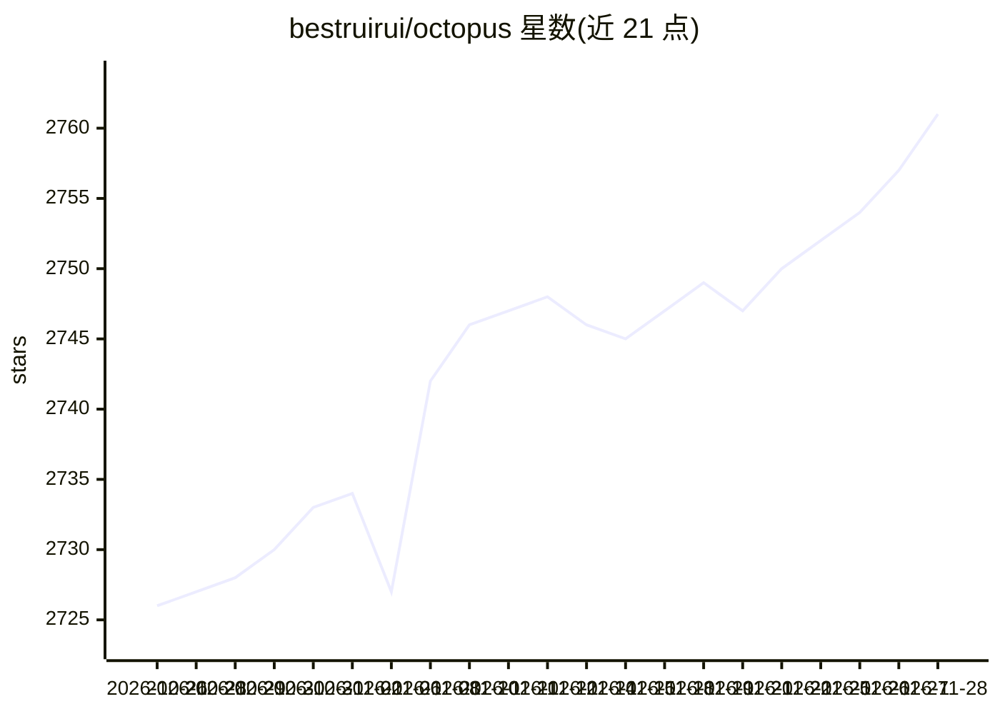

# bestruirui/octopus

⭐ 2,761 · TypeScript · AGPL-3.0 · 推送 2026-11-23 · [GitHub](https://github.com/bestruirui/octopus) · 个人维护 · 中文 README

**个人 LLM API 聚合网关：多渠道统一管理与协议转换**

用 Go 编写的 LLM API 聚合服务，面向个人用户：将多个上游渠道聚合为统一端点，支持 OpenAI Chat/Responses 与 Anthropic 三种协议格式相互转换；提供自动故障切换、上游错误拦截、模型列表与价格自动同步、请求链路可视化、用量与成本统计。单二进制部署，支持 SQLite/MySQL/PostgreSQL。安装方式包括 Docker、Release 二进制下载与源码构建（需 Go 1.24.4、Node.js 18+、pnpm）。提供 OpenAI SDK、Claude Code、Codex 客户端接入示例。

## 筛选速览

| 维度 | 判定 | 备注 |
|---|---|---|
| AI 角色 | `ai-ecosystem` | LLM/agent 周边工具 |
| 许可风险 | `viral` | AGPL-3.0 |
| 部署形态 | `self-host` | docker 或自建部署 |
| 模型依赖 | locked-api |  |
| 硬件要求 | — | 无带数字的原话,不猜 |
| 安装摩擦 | `low` | 无编译、无系统依赖或容器化 |
| 成熟度 | — | 结构信号不足 |

## 能力要点

- 多渠道聚合与统一管理，协议间自动转换（OpenAI Chat/Responses/Anthropic）
- 上游渠道故障自动切换并拦截上游错误
- 模型与价格自动同步（数据源 models.dev），含成本统计
- 单二进制部署，无外部运行时依赖

## 适用场景

- 把多个 LLM 渠道聚合成一个统一 API 供客户端调用
- 为 Claude Code / Codex 等客户端配置本地网关地址
- 跟踪 token 消耗与费用统计
- 按组统一暴露模型名并做故障切换

## 场景标签

`模型网关` · 领域:Agent 开发

## 证据(README 行号)

> L5: **A Simple, Beautiful, and Elegant LLM API Aggregation Service for Individuals**
> L16: - 🔀 **Multi-Channel Aggregation** - Connect multiple LLM provider channels with unified management
> L17: - 🔄 **Protocol Conversion** - Seamless conversion between OpenAI Chat / OpenAI Responses / Anthropic API formats

## 星数曲线

2026-10-26 2,726 → 2026-11-28 2,761（+35）

---
*卡片 v1 · prompt 1.4 · 生成 2026-11-24 · 置信度 mid · 依据 README sha `15bc5ff39692` · [字段定义](../../DATASET.md)*
