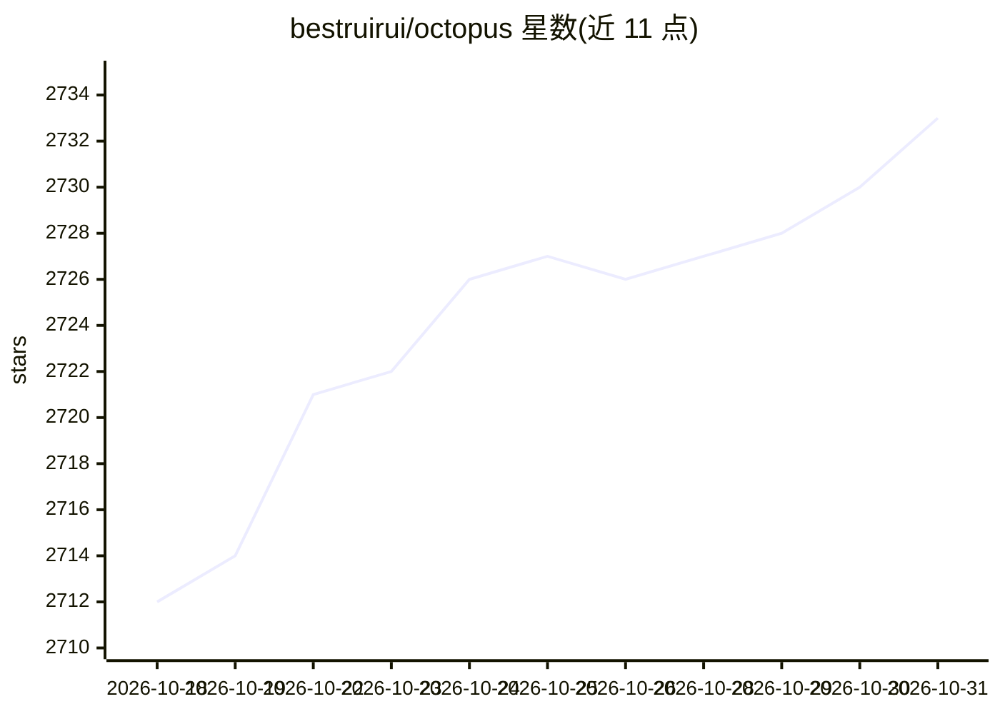

# bestruirui/octopus

⭐ 2,733 · TypeScript · AGPL-3.0 · 推送 2026-10-23 · [GitHub](https://github.com/bestruirui/octopus) · 个人维护 · 中文 README

**面向个人的 LLM API 聚合网关：多渠道统一接入与管理**

Go 编写的 LLM API 聚合网关，面向个人用户：将多个 LLM 提供商渠道统一管理，支持 OpenAI Chat / OpenAI Responses / Anthropic / Gemini 协议互转，通过 Group 机制以统一模型名对外暴露多渠道，并提供自动故障转移、上游错误屏蔽、价格与模型列表自动同步（数据来自 models.dev）、请求统计与费用追踪。部署形态为单二进制（前端嵌入）或 Docker，支持 SQLite/MySQL/PostgreSQL。文档给出 OpenAI SDK、Claude Code、Codex 的客户端接入示例。

## 筛选速览

| 维度 | 判定 | 备注 |
|---|---|---|
| AI 角色 | `ai-ecosystem` | LLM/agent 周边工具 |
| 许可风险 | `viral` | AGPL-3.0 |
| 部署形态 | `self-host` | docker 或自建部署 |
| 模型依赖 | locked-api |  |
| 硬件要求 | — | 无带数字的原话,不猜 |
| 安装摩擦 | `low` | 无编译、无系统依赖或容器化 |
| 成熟度 | — | 结构信号不足 |

## 能力要点

- 多渠道聚合与统一模型名（Group）对外暴露
- OpenAI Chat / Responses / Anthropic / Gemini 协议转换
- 自动故障转移与上游错误屏蔽
- 单二进制部署，支持 SQLite/MySQL/PostgreSQL

## 适用场景

- 把多个 LLM 提供商渠道聚合为一个统一 API 入口
- 给 Claude Code / Codex 等客户端接自管网关
- 追踪 token 消耗与费用统计

## 场景标签

`模型网关` · 领域:Agent 开发

## 证据(README 行号)

> L5: **A Simple, Beautiful, and Elegant LLM API Aggregation Service for Individuals**
> L11: - 🔀 **Multi-Channel Aggregation** - Connect multiple LLM provider channels with unified management

## 星数曲线

2026-10-18 2,712 → 2026-10-31 2,733（+21）

---
*卡片 v1 · prompt 1.4 · 生成 2026-10-21 · 置信度 mid · 依据 README sha `e35d81fefdab` · [字段定义](../../DATASET.md)*
