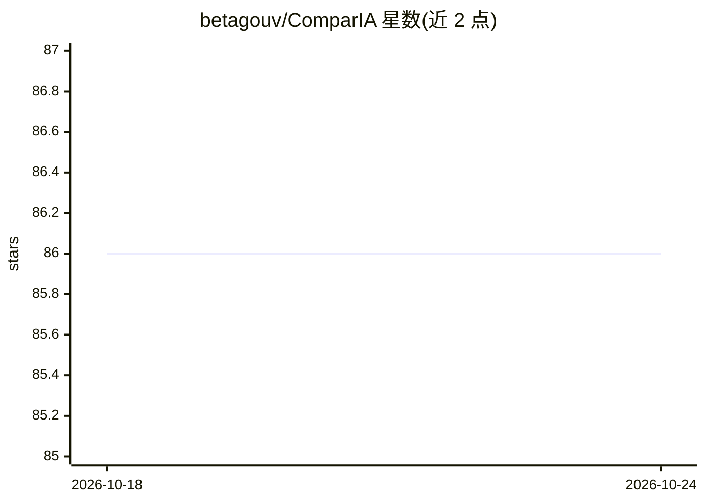

# betagouv/ComparIA

⭐ 86 · Python · Apache-2.0 · 推送 2026-10-23 · [GitHub](https://github.com/betagouv/ComparIA) · [官网](https://comparia.beta.gouv.fr/) · 组织维护

**面向组织/行业/语言的开源 LLM 竞技场平台，收集人类盲投票并发布开放数据集**

由法国政府（DINUM、文化部、ALT-EDIC）创建的开源 LLM arena：用户输入提示词，两个匿名模型回答，投票后揭晓模型名称；排行榜用 Bradley-Terry 分数（含 95% 置信区间）将盲投票转化为排名，并将提示词、投票与反应数据以开放许可（Etalab 2.0 / CC BY 4.0）发布于 Hugging Face。模型目录展示来源与技术特征，可显示 EcoLogits 能耗估算。组织可通过 Docker 自托管，配置自有模型、语言与品牌。技术栈为 FastAPI/Svelte。

## 筛选速览

| 维度 | 判定 | 备注 |
|---|---|---|
| AI 角色 | `ai-ecosystem` | LLM/agent 周边工具 |
| 许可风险 | `permissive` | Apache-2.0 |
| 部署形态 | `None` |  |
| 模型依赖 | — | README 未给出锁定关系 |
| 硬件要求 | — | 无带数字的原话,不猜 |
| 安装摩擦 | `medium` | 含编译或系统依赖之一 |
| 成熟度 | — | 结构信号不足 |

## 能力要点

- 双匿名模型对比 + 人工盲投票机制
- Bradley-Terry 排名与开放方法论/源数据
- 提示词/投票数据集以开放许可发布
- Docker 自托管与管理面板配置自有实例

## 适用场景

- 为特定语言或行业领域建立模型偏好评测
- 为研究、训练与微调收集人工偏好数据集
- 组织内部部署私有 LLM 对比平台

## 场景标签

`模型评测` · 领域:评测与运维

## 证据(README 行号)

> L18: compar:IA is an LLM arena. Enter a prompt and two anonymous models respond. Vote for the answer you prefer or skip 
> L36: The public leaderboard converts blind votes into Bradley-Terry scores with 95% confidence intervals. It measures th

## 星数曲线

2026-10-18 86 → 2026-10-24 86（+0）

---
*卡片 v1 · prompt 1.4 · 生成 2026-10-24 · 置信度 high · 依据 README sha `f6ea181f08f8` · [字段定义](../../DATASET.md)*
